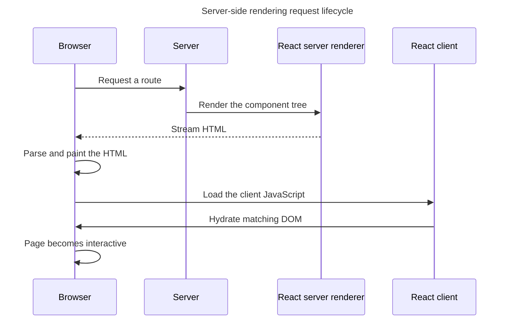

## TL;DR

Server-side rendering (SSR) renders React output to HTML on the server and sends it to the browser. `hydrateRoot` then attaches React to matching client-rendered output so interactive Client Components can work. Modern React streams with `renderToPipeableStream` for Node streams or `renderToReadableStream` for Web Streams. React 19.2 supports Web Streams in Node too, although the React team recommends Node streams there for performance. Benefits include earlier content and crawlable HTML; tradeoffs include server work, hydration cost, and mismatch risk.

---

## What is server-side rendering of React applications?

SSR combines server-produced HTML with client hydration; understanding both phases is necessary to evaluate its benefits and costs.

### Definition

Server-side rendering (SSR) is a technique where the server renders the initial HTML of a React application and sends it to the client. This is in contrast to client-side rendering (CSR), where the browser downloads a minimal HTML page and renders the content using JavaScript.

### How it works

An SSR request moves through server rendering, delivery, and client hydration in this order:

1. **Initial request**: When a user requests a page, the server processes the request.
2. **Rendering on the server**: The server uses React's server APIs (`renderToPipeableStream` on Node, `renderToReadableStream` on Web/edge runtimes) to render components into HTML.
3. **Sending HTML to the client**: The server streams the HTML to the client. With streaming SSR, the browser can start parsing and painting before the whole page is ready.
4. **Hydration**: Once the JavaScript bundle loads, the client calls `hydrateRoot` to attach event handlers to the existing DOM and resume React on the client. With selective hydration, React can hydrate parts of the tree as they become ready and prioritize the part the user is interacting with.

SSR performs server work for an incoming request, then hands the existing DOM to the client rather than rendering a second, unrelated page over it:



### Streaming SSR and React Server Components

Modern React provides two primary streaming server APIs:

- `renderToPipeableStream` for Node.js streams.
- `renderToReadableStream` for Web Streams. React 19.2 also supports it in Node, but `renderToPipeableStream` is recommended for Node because Node streams are faster and support compression more naturally.

Both let you wrap parts of the tree in `<Suspense>` so the server can flush the shell first and stream slower parts as their data resolves. React 19.2 briefly batches nearby server-rendered boundary reveals so content can appear together, using heuristics to avoid delaying important loading metrics.

React Server Components (RSC) are a separate architecture from SSR. Their component code runs on the server and is not included in the client bundle, although their rendered output can be part of the response. Modules that need state, effects, or browser APIs use the `'use client'` directive to define a client boundary. Frameworks such as Next.js App Router integrate RSC with SSR and streaming.

### Code example

Here is a basic example using Next.js's App Router, which uses async server components by default:

```jsx
// app/page.jsx — a Server Component (no 'use client' directive)
async function fetchDataFromAPI() {
  const res = await fetch('https://api.example.com/data', {
    // Opt into a request-time fetch for this example.
    cache: 'no-store',
  });
  if (!res.ok) throw new Error(`HTTP ${res.status}`);
  return res.json();
}

export default async function Home() {
  const data = await fetchDataFromAPI();

  return (
    <div>
      <h1>Welcome to my SSR React app</h1>
      <p>Data from server: {data.message}</p>
    </div>
  );
}
```

Any interactive piece (e.g. a button with `onClick`) would live in a separate file that starts with `'use client'`.

### Hydration cost and mismatches

Hydration is not free. The browser has to download, parse, and execute the JS bundle, then walk the DOM and attach handlers. For large apps this can delay Time To Interactive even though pixels appeared quickly.

Hydration mismatches occur when server HTML differs from the client's initial render—for example, rendering time or randomness independently on both sides, or branching on `window`. React 19 reports a consolidated diff and may regenerate a mismatched tree on the client. The fix is to render deterministic initial content, pass the server value to the client, or intentionally switch browser-only content after hydration.

## Benefits of server-side rendering

SSR is most useful when meaningful response HTML improves delivery or crawlability enough to justify request-time rendering and hydration.

### Improved initial load time

The timing benefit depends on server latency, streaming, caching, bundle size, and the equivalent client-rendered path.

- **Earlier content under the right conditions**: A nearby, efficiently cached or streaming server can deliver meaningful HTML before a client-rendered application finishes downloading and executing its JavaScript. SSR is not automatically faster than static HTML or every CSR application, so measure the actual route.

### Better SEO

SSR affects whether content is present in the initial response, not the full set of signals used for search ranking.

- **Crawlable response content**: Crawlers can read the server-rendered content without waiting to execute application JavaScript. That improves content availability to crawlers but does not by itself guarantee higher search rankings.

### Performance on slower devices

Server-rendered HTML can move initial document construction away from the browser, but hydration still consumes client resources.

- **HTML construction before JavaScript**: SSR lets a low-powered device display server-produced HTML before hydration. Traditional SSR still sends component JavaScript and performs client rendering during hydration; React Server Components can additionally reduce the JavaScript sent for server-only components.

## Tradeoffs to be aware of

SSR changes where and when work happens rather than removing that work entirely.

- **Higher TTFB**: Time To First Byte goes up because the server has to render before responding. Streaming SSR mitigates this by flushing the shell early, but the server is still doing work CSR pushes to the client.
- **Hydration cost**: Interactive readiness is bounded by how fast the JS bundle downloads, parses, and hydrates. Big bundles delay TTI even when pixels appear quickly.
- **Hydration mismatches**: Server and client output must agree, which constrains how you read time, randomness, and browser-only APIs during render.
- **Server cost and complexity**: You need a Node/edge runtime to render on every request, plus caching strategy for hot pages. Static generation or ISR may be a better fit for content that does not change per request.

## Further reading

- [Next.js documentation](https://nextjs.org/docs)
- [React Server Components](https://react.dev/reference/rsc/server-components)
- [`renderToPipeableStream`](https://react.dev/reference/react-dom/server/renderToPipeableStream)
- [`renderToReadableStream`](https://react.dev/reference/react-dom/server/renderToReadableStream)
- [React 19.2 release notes](https://react.dev/blog/2025/10/01/react-19-2)
- [`hydrateRoot`](https://react.dev/reference/react-dom/client/hydrateRoot)
- [`'use client'` directive](https://react.dev/reference/rsc/use-client)
