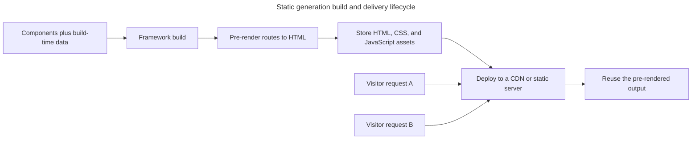

## TL;DR

Static generation (SSG) renders HTML ahead of requests, usually during a build, so the result can be cached and served from a CDN. React itself provides static rendering APIs, while frameworks decide how routes, data caches, and revalidation work. In Next.js, `generateStaticParams` can enumerate dynamic routes to prerender, but current caching is explicit rather than every fetch being static by default. SSG is best for content that does not vary per request; framework features such as revalidation and partial prerendering can combine cached shells with fresher content.

---

## Static generation of React applications and its benefits

Static generation moves rendering ahead of incoming requests so the same output can be distributed and reused efficiently.

### What is static generation?

Static generation is a method of pre-rendering where the HTML of a page is generated at build time. This means that the HTML is created once, during the build process, and then reused for each request. In the context of React applications, this is often achieved using frameworks like Next.js.

### How does static generation work?

A typical static-generation pipeline performs these stages before and during delivery:

1. **Build time rendering**: During the build process, the framework generates the HTML for each page based on the React components and data.
2. **Static files**: The generated HTML, CSS, and JavaScript files are then stored as static files.
3. **Serving the files**: These static files can be served directly from a CDN or a web server, without the need for server-side rendering on each request.

The expensive rendering step happens before traffic arrives, so many requests can reuse the same deployed output:



### Benefits of static generation

The strongest benefits come from reusing pre-rendered output rather than executing React for every request.

#### Improved performance

Pre-rendering removes request-time rendering from the critical path, subject to normal network and client costs.

- **Low and predictable server latency**: Pre-generated HTML can be served from a nearby CDN without request-time React rendering. Actual load time still depends on document size, network conditions, and client assets.
- **Reduced server load**: Static files can be served from a CDN, reducing the load on the origin server.

#### Better SEO

Static output exposes the page's content directly in the response that crawlers receive.

- **Search engine indexing**: Pre-rendered content is present in the response, so crawlers do not need to execute application JavaScript to discover it. This helps crawlability but does not guarantee search ranking.
- **Consistent content**: Every request returns the same HTML, so what crawlers see matches what users see.

#### Scalability

Serving immutable artifacts lets cache infrastructure absorb traffic without repeating application rendering.

- **CDN distribution**: Static files can be replicated across CDN edges, so traffic spikes are absorbed at the edge instead of hammering an origin.
- **Efficient caching**: Static files have stable URLs and content hashes, which makes long-lived browser and CDN caching straightforward.

### Example with Next.js (App Router)

In the Next.js App Router, `generateStaticParams` enumerates dynamic route parameters to prerender at build time. Data that should be reused must opt into the relevant cache model—for example, `cache: 'force-cache'` in the previous caching model or `use cache` with Cache Components in Next.js 16. Server Components are not inherently static; request-time data can make a route dynamic.

```jsx
// app/posts/[slug]/page.jsx
async function getPost(slug) {
  const res = await fetch(`https://api.example.com/posts/${slug}`, {
    cache: 'force-cache',
  });
  if (!res.ok) throw new Error(`HTTP ${res.status}`);
  return res.json();
}

export async function generateStaticParams() {
  const response = await fetch('https://api.example.com/posts');
  if (!response.ok) throw new Error(`HTTP ${response.status}`);
  const posts = await response.json();
  return posts.map((post) => ({ slug: post.slug }));
}

export default async function PostPage({ params }) {
  const { slug } = await params;
  const post = await getPost(slug);
  return (
    <article>
      <h1>{post.title}</h1>
      <p>{post.body}</p>
    </article>
  );
}
```

At build time Next.js calls `generateStaticParams` to learn the list of slugs, renders each `PostPage` to HTML, and ships the result as static files.

### Revalidation and partial prerendering

Frameworks can refresh cached output without rebuilding the entire site. In Next.js's previous caching model, ISR uses route- or fetch-level revalidation. With Next.js 16 Cache Components, caching and lifetimes are expressed with `use cache` and `cacheLife`, and Suspense boundaries can defer request-time content outside the prerendered shell.

```jsx
// app/posts/[slug]/page.jsx
export const revalidate = 60; // seconds

export default async function PostPage({ params }) {
  const { slug } = await params;
  const post = await getPost(slug);
  return <article>{post.title}</article>;
}
```

This `revalidate` example applies when Cache Components are disabled. Current Next.js also supports on-demand invalidation and Cache Components APIs; the exact semantics are framework- and version-specific rather than part of React itself.

### When SSG is not a good fit

Prefer request-time or client-side data for content whose identity, freshness, or route space cannot be determined safely ahead of time.

- **Per-user content**: Anything personalized (auth-gated dashboards, "hello \{user}", carts) cannot be pre-rendered for every visitor — use SSR or client-side fetching for the personalized parts.
- **Highly dynamic data**: Live prices, stock levels, scoreboards, etc. need fresher data than even ISR comfortably provides.
- **Huge or unbounded route spaces**: If a framework tries to emit millions of pages, build time and storage become a problem. Prerender a subset, generate routes on demand, or use a partial/static shell with request-time content.
- **Stale-data tradeoffs**: Plain SSG serves whatever was true at build time until the next deploy. Stale-while-revalidate ISR modes shorten that window but may serve the previous version while regeneration runs; exact behavior depends on the framework and invalidation method.

## Further reading

- [Next.js: `generateStaticParams`](https://nextjs.org/docs/app/api-reference/functions/generate-static-params)
- [Next.js: Cache Components](https://nextjs.org/docs/app/getting-started/partial-prerendering)
- [React static APIs](https://react.dev/reference/react-dom/static)
