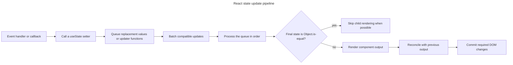

## TL;DR

Calling a `useState` setter queues either a replacement value or an updater function for the component's next render. It does not change the state variable in the currently running code because each render sees a snapshot of state. React batches updates where possible, processes queued updaters in order, renders with the resulting state, and commits any required DOM changes. If the final state is `Object.is`-equal to the current state, React can skip rendering the children. `useReducer` dispatches follow the same scheduling model; the API is distinct from class-based `this.setState`.

---

## What happens when the `useState` setter is called

The setter participates in React's queued rendering model; it does not mutate the state snapshot held by the currently running code.

### State update scheduling

When you call the setter function provided by `useState` (for example, `setCount`), React queues an update for that state variable. The update affects what `useState` returns on a subsequent render; it does not mutate the state snapshot already available to the running handler or function.

```jsx
import { useState } from 'react';

function Counter() {
  const [count, setCount] = useState(0);

  function increment() {
    setCount(count + 1);
    console.log(count); // Still the snapshot for this render
  }

  return <button onClick={increment}>Count: {count}</button>;
}
```

### Replacing object state

The `useState` setter function **replaces** the old state value entirely with the new value you provide. If your state is an object and you only want to update one property, you need to manually spread the old state and override the specific property.

```jsx
import { useState } from 'react';

function Profile() {
  const [user, setUser] = useState({ name: 'Anon', age: 99 });

  function rename() {
    setUser((previousUser) => ({ ...previousUser, name: 'John' }));
    // setUser({ name: 'John' }) would discard the `age` property.
  }

  return <button onClick={rename}>{user.name}</button>;
}
```

### Skipping work with `Object.is`

If the final state is identical to the current state according to `Object.is`, React skips re-rendering the component and its children. This is an optimization; React may still call the component before deciding it can skip the children. Mutating an existing object or array and passing the same reference back is therefore a bug: the data changed, but React sees the same state value.

```jsx
import { useState } from 'react';

function Example() {
  const [count, setCount] = useState(0);
  const [items, setItems] = useState([1, 2, 3]);

  function keepSameCount() {
    setCount(0); // Same value; React can skip the update.
  }

  function addItemIncorrectly() {
    items.push(4);
    setItems(items); // Same reference; React can skip the update.
  }

  function addItemCorrectly() {
    setItems((previousItems) => [...previousItems, 4]);
  }

  return (
    <>
      <button onClick={keepSameCount}>Keep count at {count}</button>
      <button onClick={addItemIncorrectly}>Mutate items incorrectly</button>
      <button onClick={addItemCorrectly}>Add item correctly</button>
    </>
  );
}
```

### Re-rendering

After scheduling the state update(s), React will eventually render the component again with the new state value(s). It reconciles the new component output with the previous output, then commits any required changes to the DOM.

### State snapshots and automatic batching

It is more precise to say that setters **queue an update for a future render** than to call them "asynchronous." React does not return a promise from a setter, and `await setCount(...)` has no meaning. Since React 18, **automatic batching** groups multiple updates from React events and many other callbacks—including promise callbacks, timers, and native event handlers—into fewer renders. Updates separated by an actual asynchronous boundary are not guaranteed to share one batch.

Because updates are batched, you shouldn't rely on the state variable having its new value immediately after calling the setter. If the new state depends on the previous state, use the functional updater form — the updater receives the latest **queued** state, not the value captured by closure.

```jsx
import { useState } from 'react';

function Counter() {
  const [count, setCount] = useState(0);

  function addTwoIncorrectly() {
    setCount(count + 1);
    setCount(count + 1); // Reads the same render snapshot again.
  }

  function addTwoCorrectly() {
    setCount((previousCount) => previousCount + 1);
    setCount((previousCount) => previousCount + 1);
  }

  return (
    <>
      <p>Count: {count}</p>
      <button onClick={addTwoIncorrectly}>Add one effectively</button>
      <button onClick={addTwoCorrectly}>Add two</button>
    </>
  );
}
```

If you need to opt out of batching for a specific update (rare), you can wrap it in `flushSync` from `react-dom`.

From the setter call to the screen, React processes the queued values before deciding whether any render and commit work is required:



### Updates inside transitions

When a setter is called inside `startTransition` (or via `useTransition`), React marks the resulting re-render as a **non-blocking transition**. Transition updates can be interrupted by more urgent updates such as typing and can keep the previous UI visible while the next render is prepared. Updates outside a transition generally receive higher priority, but they may still be batched and scheduled by React.

```jsx
import { startTransition, useState } from 'react';

function SearchPage() {
  const [input, setInput] = useState('');
  const [searchQuery, setSearchQuery] = useState('');

  function handleChange(event) {
    const nextQuery = event.target.value;
    setInput(nextQuery);
    startTransition(() => {
      setSearchQuery(nextQuery);
    });
  }

  return (
    <>
      <input value={input} onChange={handleChange} />
      <SearchResults query={searchQuery} />
    </>
  );
}
```

## Further reading

- [React Docs: `useState`](https://react.dev/reference/react/useState)
- [React Docs: Queueing a series of state updates](https://react.dev/learn/queueing-a-series-of-state-updates)
- [React 18 automatic batching](https://github.com/reactwg/react-18/discussions/21)
- [React Docs: `startTransition`](https://react.dev/reference/react/startTransition)
