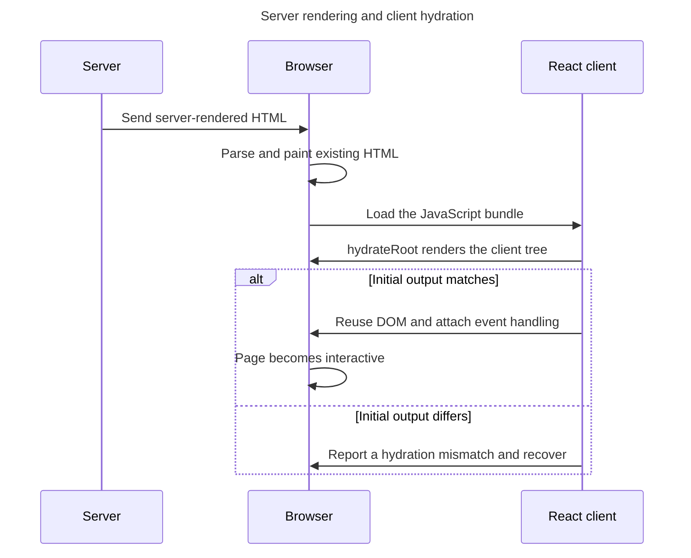

## TL;DR

Hydration is the process in which React renders the client tree, matches it to HTML previously produced by React on the server, attaches event handling, and makes the existing markup interactive. Use `hydrateRoot` rather than creating a fresh client root over server HTML. The first client output must match the server output; mismatches are bugs unless they are deliberately and narrowly suppressed.

---

## What is React hydration?

Hydration is the client phase that connects a React tree to matching HTML previously rendered on the server.

### Server-side rendering (SSR)

Server-side rendering (SSR) generates a page's initial HTML on the server and sends it to the browser. It makes content available before application JavaScript runs and exposes that content directly to crawlers, although its performance and search impact depend on the rest of the delivery architecture.

### Hydration process

Hydration is the process that happens after the server-side rendered HTML is sent to the client. React takes the static HTML and "hydrates" it by attaching event listeners and initializing the state, making the page interactive. This process involves:

1. **Matching and reusing existing HTML**: React renders the component tree on the client but reuses matching server-created DOM nodes instead of replacing them all.
2. **Attaching event listeners**: React attaches the necessary event listeners to the existing HTML elements.
3. **Initializing state**: React initializes the component state and props to make the page dynamic.

Hydration adopts the server-created DOM only when the first client render describes matching output:



### Example

Here's a simple example to illustrate the concept:

1. **Server-side rendering**: The server generates the following HTML:

   ```html
   <div id="root">
     <button>Click me</button>
   </div>
   ```

2. **Client-side hydration**: When the HTML is sent to the client, React hydrates it with the following code:

   ```jsx
   import { hydrateRoot } from 'react-dom/client';

   function App() {
     const handleClick = () => {
       alert('Button clicked!');
     };

     return <button onClick={handleClick}>Click me</button>;
   }

   hydrateRoot(document.getElementById('root'), <App />);
   ```

In this example, the server sends the static HTML with a button to the client. React then hydrates the button and makes its `onClick` behavior interactive. `ReactDOM.hydrate` was deprecated in React 18 and removed in React 19; use `hydrateRoot` from `react-dom/client`.

### Selective and streaming hydration (React 18+)

React 18 introduced **selective hydration** powered by `Suspense`. With streaming SSR (`renderToPipeableStream` / `renderToReadableStream`), the server can flush HTML in chunks as data becomes ready, and the client can hydrate parts of the tree independently — a slow `Suspense` boundary no longer blocks the rest of the page from becoming interactive. React also prioritizes hydrating the part of the tree the user is currently interacting with.

```jsx
import { Suspense } from 'react';

function Page() {
  return (
    <>
      <Header />
      <Suspense fallback={<Skeleton />}>
        <Comments />
      </Suspense>
      <Footer />
    </>
  );
}
```

### Stable IDs across server and client

Generating IDs (e.g. for `aria-labelledby` or form `htmlFor`) with `Math.random()` or counters causes hydration mismatches because the server and client produce different values. Use the `useId` hook to get a stable, deterministic ID that matches on both sides.

```jsx
import { useId } from 'react';

function Field() {
  const id = useId();
  return (
    <>
      <label htmlFor={id}>Name</label>
      <input id={id} />
    </>
  );
}
```

### Suppressing intentional mismatches

If an element's text or attribute is unavoidably different between server and client, `suppressHydrationWarning` can silence that one-level mismatch. Use it sparingly: it is an escape hatch, does not work recursively, and React does not attempt to patch mismatched text content covered by it.

```jsx
<time suppressHydrationWarning>{new Date().toISOString()}</time>
```

### What hydration enables

Hydration preserves matching server-created DOM while React connects it to the client component tree. This makes server-rendered controls interactive without discarding and rebuilding the whole document. The earlier visible content and crawlable response are benefits of prerendering; hydration is the client work needed to activate that HTML.

### Challenges of hydration

Hydration requires deterministic initial output and adds client work proportional to the interactive tree.

1. **Mismatch issues**: If the server-rendered HTML does not match the client-side React components, React logs an error. React 19 improved hydration diagnostics by consolidating mismatch information and showing a diff of relevant attributes or text, which gives a more precise starting point for debugging.
2. **Performance overhead**: Hydration can be resource-intensive on large pages. Selective hydration and breaking the tree into `Suspense` boundaries help spread the cost.

## Further reading

- [React Docs: `hydrateRoot`](https://react.dev/reference/react-dom/client/hydrateRoot)
- [React Docs: `renderToPipeableStream`](https://react.dev/reference/react-dom/server/renderToPipeableStream)
- [React Docs: `useId`](https://react.dev/reference/react/useId)
- [New Suspense SSR architecture in React 18](https://github.com/reactwg/react-18/discussions/37)
