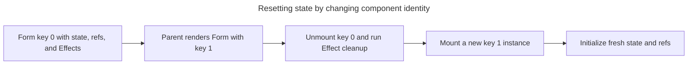

## TL;DR

The most idiomatic way to reset a component's state in React is to give the component a `key` prop and change it — React unmounts the old instance and mounts a fresh one with brand-new state. For finer-grained resets, call your `useState` setter with the initial value, or dispatch a `RESET` action when using `useReducer`.

```jsx
// Force a full reset by changing the key
<Form key={formId} />;

// Or reset specific state in place
setState(initialState);
```

---

## How do you reset a component's state in React?

Choose between remounting the subtree and updating state in place based on how much component-owned state must be discarded.

### Resetting state with a `key` prop (recommended)

The canonical React-recommended pattern is to pass a different `key` to the component you want to reset. When the `key` changes, React treats it as a new component, throws away the old state, refs, and effects, and mounts a fresh instance. This works for any state inside the subtree without the component having to know it's being reset.

```jsx
import { useState } from 'react';

function Form() {
  const [name, setName] = useState('');
  const [email, setEmail] = useState('');
  return (
    <>
      <input value={name} onChange={(e) => setName(e.target.value)} />
      <input value={email} onChange={(e) => setEmail(e.target.value)} />
    </>
  );
}

export default function App() {
  const [version, setVersion] = useState(0);
  return (
    <>
      <Form key={version} />
      <button onClick={() => setVersion((v) => v + 1)}>Reset form</button>
    </>
  );
}
```

This is the same pattern React uses to reset state when switching between items in a list — give each item a stable `key` and React handles the rest.

Changing the key changes component identity, so React tears down the old subtree before mounting a fresh one:



### Resetting `useState` in place

If you don't need to remount the component, store the initial value and pass it back to the setter. This is fine for small amounts of state but doesn't reset descendant components or refs.

```jsx
import { useState } from 'react';

const initialState = { count: 0, text: '' };

function MyComponent() {
  const [state, setState] = useState(initialState);

  const resetState = () => setState(initialState);

  return (
    <div>
      <p>Count: {state.count}</p>
      <p>Text: {state.text}</p>
      <button onClick={resetState}>Reset</button>
    </div>
  );
}
```

### Resetting `useReducer` with a `RESET` action

When state is managed by a reducer, the conventional approach is to handle a `RESET` action that returns the initial state. Keep `initialState` defined outside the component so the reducer and the component share the same source of truth.

```jsx
import { useReducer } from 'react';

const initialState = { count: 0, text: '' };

function reducer(state, action) {
  switch (action.type) {
    case 'increment':
      return { ...state, count: state.count + 1 };
    case 'setText':
      return { ...state, text: action.value };
    case 'reset':
      return initialState;
    default:
      return state;
  }
}

function MyComponent() {
  const [state, dispatch] = useReducer(reducer, initialState);
  return (
    <>
      <button onClick={() => dispatch({ type: 'reset' })}>Reset</button>
    </>
  );
}
```

### Lazy initializer for derived initial state

If computing the initial state is expensive or depends on props, pass a function to `useState` (or the third argument to `useReducer`). React uses the initializer for the initial state, so later re-renders do not recompute it. Development Strict Mode calls a pure initializer twice and ignores one result.

```jsx
import { useState } from 'react';

function MyComponent({ initialCount }) {
  // React uses this function to calculate the initial state. To reset later,
  // call the setter with a freshly computed value.
  const [state, setState] = useState(() => ({
    count: initialCount,
    text: '',
  }));

  const resetState = () => setState({ count: initialCount, text: '' });

  return <button onClick={resetState}>Reset</button>;
}
```

For `useReducer`, pass `(initialArg, init)` to do the same:

```js
const [state, dispatch] = useReducer(reducer, initialCount, (count) => ({
  count,
  text: '',
}));
```

### A note on class components

React recommends function components for new code, but class components remain supported. In an existing class component, reset state with `this.setState(...)` using a fresh initial value; the `key` reset pattern also works for an entire class-component subtree.

## Further reading

- [React useState Hook](https://react.dev/reference/react/useState)
- [React useReducer Hook](https://react.dev/reference/react/useReducer)
- [Resetting state with a key (React docs)](https://react.dev/learn/preserving-and-resetting-state#resetting-state-with-a-key)
- [State: A component's memory](https://react.dev/learn/state-a-components-memory)
