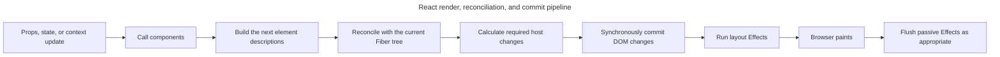

## TL;DR

The "virtual DOM" is not a copy of the browser DOM. It is shorthand for the React element descriptions produced by components, together with React's internal Fiber tree. During rendering, React reconciles a new description with the previous one; during commit, it applies the required host-environment changes. This model enables declarative UI, batching, interruption, and multiple renderers, but diffing and retaining an extra tree have costs. It is a predictable update strategy, not a guarantee that React beats carefully written direct DOM code.

---

## How does virtual DOM in React work?

React uses in-memory element and Fiber trees to calculate host updates before committing them to the renderer.

### What is the virtual DOM?

"Virtual DOM" is an informal label for React's in-memory representation of the UI. Components return immutable React elements that describe what should be rendered; React also maintains an internal Fiber tree that tracks component identity, state, and work. Neither structure is a clone of the real DOM.

The overall update cycle has two phases:

- **Render phase (reconciliation)**: React calls components and calculates the next tree and host changes. Rendering must be pure; eligible concurrent work can be paused, resumed, or discarded before commit.
- **Commit phase**: React applies the calculated changes to the real DOM and runs layout effects; passive effects run afterward. Committing a root is synchronous and cannot be interrupted.

### How does it work?

At a high level, React moves from a render description to reconciliation and then a host commit:

1. **Initial render**: When a React component first renders, React builds a tree of elements (the virtual DOM) and a parallel internal Fiber tree. It then commits the corresponding nodes to the real DOM.
2. **State change**: When state or props change, React schedules a re-render and builds a new element tree from the updated component output.
3. **Diffing**: React walks the new tree and compares it with the previous one. The algorithm runs in O(n) by relying on two heuristics: elements of different types produce different trees, and the developer hints which children are stable across renders by giving them a `key`.
4. **Commit**: React applies the required insertions, updates, and deletions to the real DOM, runs layout effects, lets the browser paint, and later flushes passive effects as appropriate.

Only the final commit mutates the host environment; React can restart or discard eligible work while it is still calculating the next tree:



### Fiber, keys, and concurrent rendering

Fiber records units of work, while keys preserve sibling identity across successive element trees.

- **Fiber** is the data structure React has used since v16 to represent work-in-progress trees. It lets React pause or abandon eligible rendering work and switch to a higher-priority update, which underpins concurrent features such as transitions, `Suspense`, and `useDeferredValue`. Synchronous work can still block.
- **Keys** are how you tell React which children are the same across renders. Without stable keys (or with index keys on a reordered list), React assumes positional equality and may unnecessarily unmount and remount components, losing state.
- **Concurrent rendering** lets React work on multiple versions of the tree at once, mark some updates as non-urgent, and bail out if a higher-priority update arrives — all built on top of the virtual DOM / Fiber model.
- **React Compiler 1.0** is an optional build-time optimizer. When enabled, it can memoize compatible components and values, reducing work before reconciliation without changing the runtime reconciliation model.

### Code example

This component produces a new element description when its state changes; React then commits only the required host changes:

```jsx
import { useState } from 'react';

function MyComponent() {
  const [count, setCount] = useState(0);

  const increment = () => setCount((c) => c + 1);

  return (
    <div>
      <p>{count}</p>
      <button onClick={increment}>Increment</button>
    </div>
  );
}
```

When the button is clicked, React renders a new element tree, diffs it against the previous one, sees that only the `<p>` text changed, and updates just that text node in the real DOM.

## Benefits of virtual DOM

The model's main value is declarative coordination and scheduling, not a guarantee that every update beats hand-written DOM code.

### Predictable, batched host updates

React can calculate a coherent commit from multiple queued component updates.

- **Targeted updates**: React computes which host nodes need to change and avoids replacing unaffected DOM subtrees. The diff itself is additional JavaScript work, so this should not be interpreted as universally faster than direct DOM manipulation.
- **Batched updates**: React 18+ automatically batches updates from React events and many other callbacks, including promise callbacks, timers, and native event handlers. Updates separated by an `await` or another actual asynchronous boundary are not guaranteed to share a batch.

### Declarative UI

The element tree lets application code describe desired output instead of sequencing most DOM mutations manually.

- **Simplified development**: You describe what the UI should look like for a given state and React figures out how to get there. Application code rarely needs to read from or imperatively mutate the DOM.

### Enables advanced rendering features

Keeping work separate from the committed host tree lets React schedule eligible rendering before mutating visible output.

- **Concurrent rendering**: The ability to compute renders off-DOM is what makes interruptible rendering, transitions, and `Suspense` possible.
- **Renderer flexibility**: The same component model powers other renderers (React Native, react-three-fiber, custom renderers). Note however that React Native does not use a browser-style virtual DOM that diffs against HTML elements — it diffs against native view nodes via a separate renderer. The shared piece is React's reconciliation, not the DOM itself.

## Downsides of virtual DOM

The abstraction adds runtime work and concepts that applications must understand and profile.

### Complexity

Correctness and performance depend on learning React's identity, render, and Effect rules.

- **Learning curve**: Understanding rendering, reconciliation, keys, and effects takes time, and incorrect mental models lead to subtle bugs.
- **Overhead**: For very simple, mostly static UIs, the cost of maintaining a virtual tree is real even if usually small.

### Performance limitations

Reconciliation is a general-purpose strategy with overhead that can matter in specialized workloads.

- **Not a silver bullet**: A diff is still work. Targeted imperative DOM updates, compiler-driven frameworks, or fine-grained reactive systems can outperform React on particular workloads; measure the interaction that matters.

## Further reading

- [Render and commit (React docs)](https://react.dev/learn/render-and-commit)
- [Preserving and resetting state (React docs)](https://react.dev/learn/preserving-and-resetting-state)
- [React Fiber Architecture](https://github.com/acdlite/react-fiber-architecture)
- [React Compiler documentation](https://react.dev/learn/react-compiler)
- [What is the Virtual DOM in React?](https://www.freecodecamp.org/news/what-is-the-virtual-dom-in-react/)
