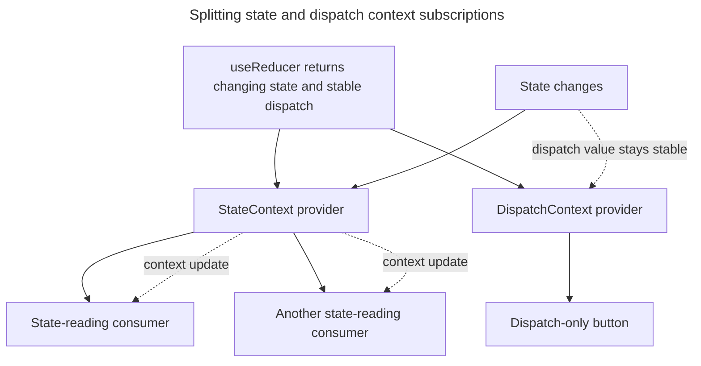

## TL;DR

Context consumers re-render whenever the provider receives a different `value` according to `Object.is`. Neither `memo` nor React Compiler prevents that subscription update. Keep provider values stable, split unrelated or differently changing data into separate contexts, and separate state from a stable dispatch function so dispatch-only consumers do not re-render on state changes. Use `memo` to protect expensive descendants below a consumer, and consider selector-based state libraries when consumers need independent slices of frequently changing state.

```javascript
const value = useMemo(() => ({ state, dispatch }), [state, dispatch]);
```

---

## How to optimize the performance of React contexts to reduce rerenders

Context optimization starts by reducing unnecessary provider identity changes and narrowing which components subscribe to each value.

### Know what React Compiler can and cannot optimize

React Compiler 1.0 is an optional build-time optimizer. When enabled, it can memoize components and values and reduce re-renders that come from unchanged props or parent renders. It can often replace hand-written `memo`, `useMemo`, and `useCallback`, but it does not change Context's subscription semantics.

Every component that reads a context re-renders when its closest provider receives a different `value` according to `Object.is`. The patterns below control when that value changes and reduce how many components subscribe to it. Profile before and after optimizing; a re-render that produces the same output is not automatically a performance problem.

### Split state and dispatch into two contexts

A common effective pattern is splitting a context into two: one that exposes the frequently changing state and another that exposes the stable updater. Components that only need to dispatch do not receive a context update when state changes because the dispatch context's value remains stable.

```jsx
import { createContext, useContext, useReducer } from 'react';

const StateContext = createContext(null);
const DispatchContext = createContext(null);

function reducer(state, action) {
  switch (action.type) {
    case 'increment':
      return { count: state.count + 1 };
    case 'decrement':
      return { count: state.count - 1 };
    default:
      throw new Error(`Unknown action: ${action.type}`);
  }
}

const initialState = { count: 0 };

export function CounterProvider({ children }) {
  const [state, dispatch] = useReducer(reducer, initialState);

  // No need to memoize `dispatch` — useReducer guarantees it's stable.
  // Memoize state only if you wrap it in an object.
  return (
    <DispatchContext.Provider value={dispatch}>
      <StateContext.Provider value={state}>{children}</StateContext.Provider>
    </DispatchContext.Provider>
  );
}

export const useCounterState = () => useContext(StateContext);
export const useCounterDispatch = () => useContext(DispatchContext);
```

A button that only dispatches actions can call `useCounterDispatch()` without subscribing to `StateContext`, so a state update alone does not re-render it through context. It can still re-render for other reasons, such as its parent rendering or its own state changing.

Splitting the providers narrows the subscription fan-out when state changes:



### Memoize the value object you pass to a provider

If you must pass a single object value, memoize it so its reference is stable across renders. Note that hook return values like `dispatch` from `useReducer` and the setter from `useState` are already referentially stable — you don't need to include them in the dependency list.

```jsx
import { createContext, useMemo } from 'react';

const MyContext = createContext(null);

function MyProvider({ state, children }) {
  const value = useMemo(() => ({ state }), [state]);
  return <MyContext.Provider value={value}>{children}</MyContext.Provider>;
}
```

### Memoize expensive descendants of consumers

When a context value changes, `memo` cannot stop a component that reads that context from re-rendering. A consumer can instead pass a derived value to a memoized child, allowing that child to skip work when its props are unchanged:

```jsx
import { memo, useContext } from 'react';

const Item = memo(function Item({ id }) {
  return <ExpensiveItemDetails id={id} />;
});

function SelectedItem() {
  const { selectedItem } = useContext(ItemsContext);
  return <Item id={selectedItem.id} />;
}
```

This composes well with split contexts: a dispatch-only consumer receives no context update when state changes, while a state consumer can re-render without necessarily re-rendering memoized descendants.

### Use the `use(Context)` API for conditional reads

React 19 added the `use` API, which can read a context inside conditionals or loops. Despite its name, `use` is not a Hook. It still subscribes the component to that context whenever the read occurs; conditional placement does not make updates cheaper by itself.

```jsx
import { use } from 'react';
import { ThemeContext } from './theme-context';

function Avatar({ showTheme }) {
  if (showTheme) {
    const theme = use(ThemeContext);
    return ;
  }

  return ;
}
```

### Selectors with `use-context-selector`

For very large context values where consumers only care about a slice, `use-context-selector` lets a component subscribe to a derived value and only rerender when that derived value changes. **Important**: `use-context-selector` requires using its own `createContext`, not React's built-in one — selectors don't work with a context created by `react`.

```jsx
import { createContext, useContextSelector } from 'use-context-selector';

const MyContext = createContext(null);

function Counter() {
  // Only rerenders when `state.count` changes, even if other parts of the
  // value change.
  const count = useContextSelector(MyContext, (v) => v.state.count);
  return <div>{count}</div>;
}
```

For frequently changing shared state with many independent slices, compare a dedicated state library such as Zustand, Jotai, or Redux Toolkit. Their selector-based subscriptions can narrow store-driven updates, at the cost of another abstraction and dependency.

## Further reading

- [React documentation on context](https://react.dev/learn/passing-data-deeply-with-context)
- [Scaling up with reducer and context (React docs)](https://react.dev/learn/scaling-up-with-reducer-and-context)
- [`use` API reference](https://react.dev/reference/react/use)
- [React Compiler documentation](https://react.dev/learn/react-compiler)
- [`useMemo` hook documentation](https://react.dev/reference/react/useMemo)
- [`use-context-selector` library](https://github.com/dai-shi/use-context-selector)
