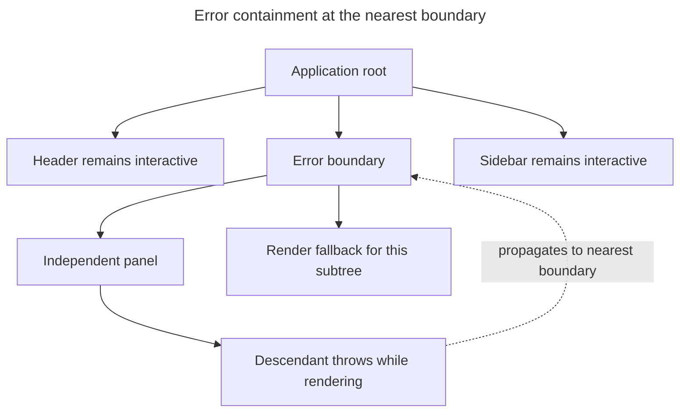

## TL;DR

Error boundaries catch errors thrown while rendering their descendant tree and display fallback UI instead of losing the entire React root. They are class components that use `static getDerivedStateFromError` to render a fallback and may use `componentDidCatch` for logging. Place them at meaningful recovery boundaries such as routes or independent panels. They do not catch event-handler errors, errors in arbitrary asynchronous callbacks, server-rendering errors, or errors thrown by the boundary itself. React has no function-component API for defining a boundary; a library can provide a reusable boundary component. React 19 also provides root options for reporting caught, uncaught, and recoverable errors, but those reporting callbacks do not replace fallback UI.

---

## What are error boundaries in React for?

Error boundaries contain render-time failures in a subtree and replace that subtree with fallback UI instead of losing the entire interface.

### Introduction

Error boundaries catch render-time errors in their descendant component tree. They can report the error and replace only the failed subtree with fallback UI instead of allowing the error to unmount the entire root.

Specifically, an error boundary catches errors thrown during:

- Rendering of its descendants
- Lifecycle methods of its descendants
- Constructors of its descendants

Since React 16, if an error is not caught by any boundary, React unmounts the entire component tree from the root. In production, place boundaries where the application can present a useful fallback and let unaffected areas remain interactive.

### How to implement error boundaries

As of React 19, error boundaries must still be class components — there is no hooks-based equivalent. To create one, define a class component that implements at least one of the following methods:

- `static getDerivedStateFromError(error)`: Updates state so the next render shows the fallback UI. This alone is sufficient to render a fallback.
- `componentDidCatch(error, info)`: Used to log error information to an error reporting service. It is optional and not required to render a fallback.

Here is an example of an error boundary component:

```jsx
import React, { Component } from 'react';

class ErrorBoundary extends Component {
  constructor(props) {
    super(props);
    this.state = { hasError: false };
  }

  static getDerivedStateFromError(error) {
    // Update state so the next render shows the fallback UI
    return { hasError: true };
  }

  componentDidCatch(error, errorInfo) {
    // You can also log the error to an error reporting service
    console.error('Error caught by ErrorBoundary: ', error, errorInfo);
  }

  render() {
    if (this.state.hasError) {
      // You can render any custom fallback UI
      return <h1>Something went wrong.</h1>;
    }

    return this.props.children;
  }
}

export default ErrorBoundary;
```

### Usage

To use the error boundary, wrap it around any component that you want to monitor for errors:

```jsx
<ErrorBoundary>
  <MyComponent />
</ErrorBoundary>
```

The boundary contains only its descendant subtree; siblings outside that boundary can remain mounted and interactive:



### Limitations

Error boundaries have some limitations:

- They do not catch errors inside event handlers. For event handlers, you need to use regular JavaScript `try`/`catch` blocks.
- They do not catch errors in asynchronous code (e.g., `setTimeout` or `requestAnimationFrame` callbacks).
- They do not catch errors during server-side rendering.
- They do not catch errors thrown in the error boundary itself — those propagate up to the next error boundary above it in the tree (or unmount the whole root if none exists).

### Root-level error handlers (React 19)

React 19 added reporting options on `createRoot` and `hydrateRoot`, useful for centralized logging and analytics. `onCaughtError` reports errors handled by a boundary, while `onUncaughtError` reports errors that reached the root without one:

```js
import { createRoot } from 'react-dom/client';

const root = createRoot(document.getElementById('root'), {
  onUncaughtError: (error, errorInfo) => {
    // Errors not caught by any error boundary
    console.error('Uncaught error:', error, errorInfo.componentStack);
  },
  onCaughtError: (error, errorInfo) => {
    // Errors caught by an error boundary
    console.error('Caught error:', error, errorInfo.componentStack);
  },
  onRecoverableError: (error, errorInfo) => {
    // Errors React recovered from automatically (e.g. hydration mismatches)
    console.error('Recoverable error:', error, errorInfo.componentStack);
  },
});
```

These complement error boundaries — they do not replace them.

### The `react-error-boundary` library

If you do not want to maintain a class wrapper, the [`react-error-boundary`](https://github.com/bvaughn/react-error-boundary) library is one reusable option. It exposes an `<ErrorBoundary>` component plus a `useErrorBoundary` hook for forwarding errors from function components to the nearest boundary.

### Best practices

Place boundaries according to the failures users should be able to recover from independently:

- Place error boundaries around route content or independent sections that can fail and recover separately.
- Log errors to an error reporting service to keep track of issues in production.
- Give the fallback an actionable recovery path, such as retrying, navigating away, or reloading the affected data.

## Further reading

- [React documentation on error boundaries](https://react.dev/reference/react/Component#catching-rendering-errors-with-an-error-boundary)
- [`createRoot` options for error handling](https://react.dev/reference/react-dom/client/createRoot#parameters)
- [`react-error-boundary` library](https://github.com/bvaughn/react-error-boundary)
