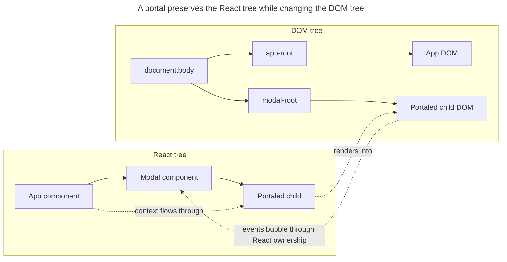

## TL;DR

React Portals are used to render children into a DOM node that exists outside the hierarchy of the parent component. This is useful for scenarios like modals, tooltips, and dropdowns where you need to break out of the parent component's overflow or z-index constraints. You create a portal with `createPortal(child, container)` from `react-dom`. Even though the rendered DOM lives elsewhere, the portal still belongs to the React tree, so events bubble up to the React parent and context still flows through normally.

---

## What are React Portals used for?

Portals separate a child's DOM placement from its ownership in the React component tree.

### Introduction

React Portals provide a way to render children into a DOM node that exists outside the DOM hierarchy of the parent component. This is particularly useful for certain UI patterns that require breaking out of the normal parent-child DOM structure.

### Use cases

Overlays are the most common portal use case because they often need to escape clipping and stacking contexts:

#### Modals

Modals often need to be rendered outside the parent component to avoid issues with z-index and overflow. By using a portal, you can ensure the modal is rendered at the top level of the DOM, making it easier to manage its visibility and positioning.

```jsx
import { createPortal } from 'react-dom';

function Modal({ isOpen, children, titleId }) {
  if (!isOpen) return null;

  return createPortal(
    <div
      aria-labelledby={titleId}
      aria-modal="true"
      className="modal"
      role="dialog">
      {children}
    </div>,
    document.getElementById('modal-root'),
  );
}
```

This abbreviated example only demonstrates portal placement. A production modal must also manage focus, dismissal, and background interaction as described in the accessibility section below.

#### Tooltips

Tooltips need to be rendered outside the parent component to avoid being clipped by overflow settings. Using a portal lets the tooltip escape ancestor `overflow: hidden` and stacking-context constraints. To position the tooltip relative to its target element, use `getBoundingClientRect()` (which gives viewport-relative coordinates) and add the current scroll offsets — `offsetTop` / `offsetLeft` are relative to the nearest positioned ancestor (`offsetParent`) and produce the wrong values once the tooltip is portaled into `document.body`.

```jsx
import { useLayoutEffect, useState } from 'react';
import { createPortal } from 'react-dom';

const Tooltip = ({ text, targetRef }) => {
  const [position, setPosition] = useState({ top: 0, left: 0 });

  useLayoutEffect(() => {
    const target = targetRef.current;
    if (!target) return;

    function updatePosition() {
      const rect = target.getBoundingClientRect();
      setPosition({
        top: rect.bottom + window.scrollY,
        left: rect.left + window.scrollX,
      });
    }

    updatePosition();
    window.addEventListener('resize', updatePosition);
    window.addEventListener('scroll', updatePosition, true);

    const resizeObserver = new ResizeObserver(updatePosition);
    resizeObserver.observe(target);

    return () => {
      window.removeEventListener('resize', updatePosition);
      window.removeEventListener('scroll', updatePosition, true);
      resizeObserver.disconnect();
    };
  }, [targetRef]);

  return createPortal(
    <div className="tooltip" style={{ position: 'absolute', ...position }}>
      {text}
    </div>,
    document.body,
  );
};
```

#### Dropdowns and popovers

Dropdown menus, comboboxes, and other popover-style UIs benefit from portals for the same reason as tooltips: they often need to escape an ancestor's `overflow: hidden`, `transform`, or stacking context. A portal lets the menu render at the top of the DOM while still being part of the React tree, which means clicks and keyboard events still bubble up to the parent dropdown component for state handling.

```jsx
import { createPortal } from 'react-dom';

const Dropdown = ({ isOpen, children }) => {
  if (!isOpen) return null;

  return createPortal(
    <div className="dropdown">{children}</div>,
    document.body,
  );
};
```

### How to create a portal

To create a portal, import `createPortal` from `react-dom`. It takes the React content to render and the DOM node to render it into.

```js
import { createPortal } from 'react-dom';

createPortal(child, container);
```

### Event bubbling follows the React tree

A subtle but commonly tested point: even though the portal's DOM node lives elsewhere in the document, React events (`onClick`, `onChange`, etc.) bubble up through the React component tree, not the DOM tree. So a click inside a portaled modal will trigger an `onClick` handler on the modal's React parent, even if that parent is on the other side of the document. Context also flows through portals normally.

The child therefore occupies one position for React ownership and another for physical DOM placement:



### Server-side rendering

`createPortal` requires a real DOM node, which doesn't exist during server-side rendering. A common pattern is to initialize a `mounted` state to `false`, set it to `true` in an Effect, and return `null` until then. The server and the client's first render consequently match. A `typeof window !== 'undefined'` branch directly in render can instead produce different initial markup and cause a hydration mismatch.

### Accessibility

Portals are commonly used for modals and dialogs, which come with accessibility expectations: focus should move into the dialog when it opens and be trapped inside it (Tab/Shift+Tab cycles within the dialog), Escape should close it, and focus should return to the triggering element on close. The dialog itself needs an appropriate role (`role="dialog"` or the native `<dialog>` element) and an accessible label. Implementing focus traps correctly is non-trivial, so most teams rely on libraries like Radix UI, React Aria, or Headless UI rather than rolling their own.

### Benefits

Portals solve placement constraints while preserving React relationships such as context and event propagation.

- **Breaking out of parent constraints**: Portals allow you to render components outside the parent component's DOM hierarchy, which is useful for avoiding issues with z-index, overflow, and `transform`-based stacking contexts.
- **Preserves the React tree**: Events bubble and context flows through portals as if the children were still nested under the parent component, so the rest of your code keeps working the way you'd expect.
- **Independent overlay layer**: Rendering overlays into a shared top-level container makes their stacking and positioning rules easier to manage, although the overlay still needs explicit styles and interaction behavior.

## Further reading

- [`createPortal` documentation (react.dev)](https://react.dev/reference/react-dom/createPortal)
- [Building a modal in React with React Portals](https://blog.logrocket.com/build-modal-with-react-portals/)
