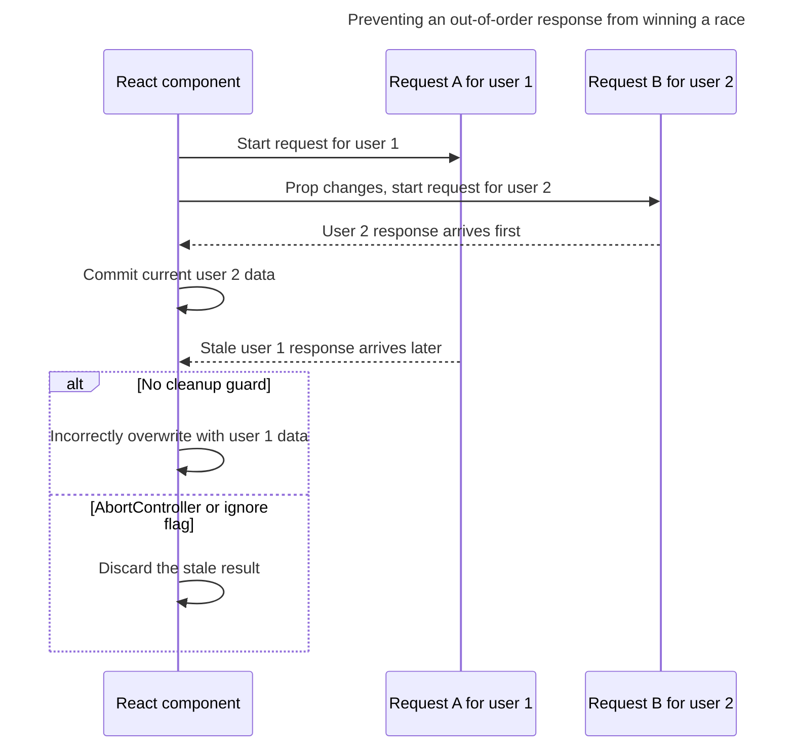

## TL;DR

Common data-fetching pitfalls include missing loading and error states, ignoring HTTP error statuses, leaving stale requests active, allowing responses to win races, recreating promises during render, and triggering request waterfalls. Prefer framework loaders or a client cache when they fit. For manual Effect-based fetching, clean up with `AbortController` and handle Strict Mode's extra development setup/cleanup cycle. React 19's `use` API can read a cached promise with Suspense, but it does not make an ordinary `fetch()` created during render safe.

---

## Common pitfalls when doing data fetching in React

Reliable data loading must coordinate request lifetime, response ordering, HTTP semantics, rendering state, and cache ownership.

### Not handling loading and error states

When fetching data, it's crucial to manage the different states of the request: loading, success, and error. Failing to do so can lead to a poor user experience.

```jsx
import { useEffect, useState } from 'react';

function MyComponent() {
  const [data, setData] = useState(null);
  const [loading, setLoading] = useState(true);
  const [error, setError] = useState(null);

  useEffect(() => {
    const controller = new AbortController();

    fetch('https://api.example.com/data', { signal: controller.signal })
      .then((response) => {
        if (!response.ok) throw new Error(`HTTP ${response.status}`);
        return response.json();
      })
      .then((data) => {
        setData(data);
        setLoading(false);
      })
      .catch((error) => {
        if (error.name === 'AbortError') return;
        setError(error);
        setLoading(false);
      });

    return () => controller.abort();
  }, []);

  if (loading) return <div>Loading...</div>;
  if (error) return <div>Error: {error.message}</div>;
  return <div>{JSON.stringify(data)}</div>;
}
```

### Not aborting in-flight requests on unmount

If a component unmounts (or its effect re-runs) before a fetch resolves, calling `setState` afterwards is wasted work and previously triggered React's "state update on unmounted component" warning. Since React 18, the recommended fix is `AbortController` — it both stops the network request and prevents the resolve handler from running.

```jsx
import { useEffect, useState } from 'react';

function MyComponent() {
  const [data, setData] = useState(null);
  const [error, setError] = useState(null);

  useEffect(() => {
    const controller = new AbortController();
    let ignore = false;

    fetch('https://api.example.com/data', { signal: controller.signal })
      .then((response) => {
        if (!response.ok) throw new Error(`HTTP ${response.status}`);
        return response.json();
      })
      .then((data) => {
        if (!ignore) setData(data);
      })
      .catch((error) => {
        if (!ignore && error.name !== 'AbortError') setError(error);
      });

    return () => {
      ignore = true;
      controller.abort();
    };
  }, []);

  if (error) return <p role="alert">{error.message}</p>;
  if (data === null) return <p>Loading...</p>;
  return <pre>{JSON.stringify(data, null, 2)}</pre>;
}
```

An Effect-local `ignore` flag can prevent a stale response from committing state and therefore can handle races, including for asynchronous APIs that cannot be canceled. It does not stop the underlying network request. For `fetch`, prefer `AbortController` so cleanup both prevents the stale commit and cancels the request.

### Race conditions when props or query params change

If a fetch depends on a prop (such as a user ID) and the prop changes before the previous request resolves, responses can arrive out of order and the stale one can overwrite the fresh one. Cleanup can abort the superseded fetch, while an ignore flag prevents its handlers from committing stale state:



```jsx
import { useEffect, useState } from 'react';

function UserProfile({ userId }) {
  const [user, setUser] = useState(null);

  useEffect(() => {
    const controller = new AbortController();
    let ignore = false;

    fetch(`/api/users/${userId}`, { signal: controller.signal })
      .then((response) => {
        if (!response.ok) throw new Error(`HTTP ${response.status}`);
        return response.json();
      })
      .then((data) => {
        if (!ignore) setUser(data);
      })
      .catch((error) => {
        if (!ignore && error.name !== 'AbortError') console.error(error);
      });

    return () => {
      ignore = true;
      controller.abort();
    };
  }, [userId]);

  return user === null ? <p>Loading...</p> : <h1>{user.name}</h1>;
}
```

### Forgetting Strict Mode's extra development checks

In development with `<StrictMode>`, React performs an extra Effect setup-and-cleanup cycle before the real setup. If a fetch or subscription appears duplicated, treat it as a signal that the Effect needs correct cleanup. Mutations such as analytics events or POST requests usually belong in the user event that caused them, not in an Effect that runs because a component appeared.

### Creating an uncached request during render

Calling `fetch` directly in a Client Component's render body creates a new promise on every attempt. If its handler sets state, it also creates a render loop. Suspense does support reading promises during render through `use`, but the promise must be cached so the same instance is reused.

```jsx
// Incorrect — fetch runs every render
function MyComponent() {
  const [data, setData] = useState(null);

  // This fires a request on every render. If `setData` is called inside,
  // each render schedules another render → infinite loop.
  fetch('https://api.example.com/data')
    .then((response) => response.json())
    .then((data) => setData(data));

  return <div>{JSON.stringify(data)}</div>;
}

// Correct — run the side effect inside useEffect and clean it up
function MyComponent() {
  const [data, setData] = useState(null);

  useEffect(() => {
    const controller = new AbortController();
    fetch('https://api.example.com/data', { signal: controller.signal })
      .then((response) => {
        if (!response.ok) throw new Error(`HTTP ${response.status}`);
        return response.json();
      })
      .then((data) => setData(data))
      .catch((error) => {
        if (error.name !== 'AbortError') console.error(error);
      });
    return () => controller.abort();
  }, []);

  return <div>{JSON.stringify(data)}</div>;
}
```

### Missing or incorrect dependencies in `useEffect`

The dependency array tells React when to re-run an effect. Omitting a value the effect actually reads (such as `userId`) leaves you with stale data. Including a value that changes on every render (such as a freshly created object or function) will re-fire the effect on every render, which can create a fetch loop. This abbreviated comparison isolates the dependency mistake; a complete request still needs the HTTP checks, error state, and cleanup shown above.

```js
// Incorrect — uses `userId` but doesn't list it; data goes stale.
useEffect(() => {
  fetch(`/api/users/${userId}`)
    .then((r) => r.json())
    .then(setUser);
}, []);

// Correct dependency list (request handling abbreviated)
useEffect(() => {
  fetch(`/api/users/${userId}`)
    .then((r) => r.json())
    .then(setUser);
}, [userId]);
```

Let `eslint-plugin-react-hooks` (`exhaustive-deps`) catch these for you.

### Request waterfalls

Fetching one resource, waiting for it, then fetching the next from a child component creates a serial waterfall. If the requests don't depend on each other, kick them off in parallel with `Promise.all`, or hoist them to a parent / loader / Server Component so they start at the same time.

### Skipping caching, deduplication, and retries

Hand-rolled `useEffect + fetch` has no cache, no deduping, no retries, no background refetching, no stale-while-revalidate. For anything beyond a one-off request, reach for a dedicated library:

- **TanStack Query** (`@tanstack/react-query`) — caching, dedup, retries, background refresh.
- **SWR** — small, focused on stale-while-revalidate.
- **RTK Query** — built on Redux Toolkit, good fit if you already use Redux.

### Misusing React 19's `use()` and Suspense

In React 19, `use()` can read a cached promise and let Suspense handle the pending state. The promise must be reused across renders and should usually come from a Server Component, route loader, or Suspense-enabled cache. Recreating `fetch()` inside the component will repeatedly suspend instead of completing:

```jsx
import { use, Suspense } from 'react';

function User({ userPromise }) {
  const user = use(userPromise); // suspends until the promise resolves
  return <div>{user.name}</div>;
}

function App({ userPromise }) {
  return (
    <Suspense fallback={<div>Loading...</div>}>
      <User userPromise={userPromise} />
    </Suspense>
  );
}
```

Choose the loading layer based on the application: Server Components or route loaders avoid client waterfalls when the framework supports them, while a client cache is appropriate for browser-owned server state and background refetching. Effect-based fetching remains a low-level option for simpler cases.

## Further reading

- [React documentation on `useEffect`](https://react.dev/reference/react/useEffect)
- [`use` API reference](https://react.dev/reference/react/use)
- [Suspense](https://react.dev/reference/react/Suspense)
- [You Might Not Need an Effect](https://react.dev/learn/you-might-not-need-an-effect)
- [TanStack Query](https://tanstack.com/query/latest)
- [SWR](https://swr.vercel.app/)
