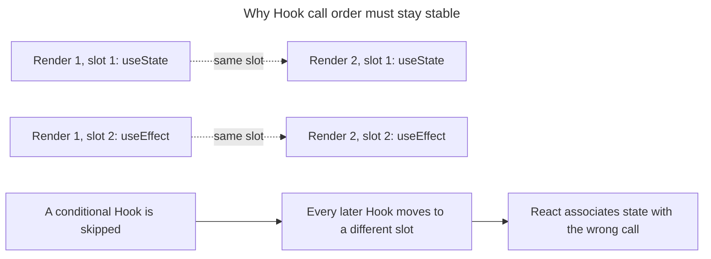

## TL;DR

React hooks have a few essential rules to ensure they work correctly. Call hooks at the top level of a function component or custom hook — never inside loops, conditions, nested functions, or after an early `return`. The `use` API is the exception: it is not a Hook and may be called conditionally or in loops, but it must still run inside a component or Hook and cannot be wrapped in `try`/`catch`. Lean on `eslint-plugin-react-hooks` to enforce these rules.

---

## What are the rules of React hooks?

The Rules of Hooks preserve a consistent call order so React can associate each Hook call with the correct component state across renders.

### Always call hooks at the top level

Hooks must be called in the same order on every render. That means you cannot call them inside loops, conditions, nested functions, or after an early `return`. React identifies which `useState`/`useEffect`/etc. call corresponds to which piece of state purely by call order — break the order and React's internal bookkeeping desyncs.

```jsx
import { useState } from 'react';

function Counter({ enabled }) {
  const [count, setCount] = useState(0);

  if (!enabled) return null;

  return (
    <button onClick={() => setCount((value) => value + 1)}>{count}</button>
  );
}

// Incorrect — hook inside an `if`
function ConditionalCounter({ enabled }) {
  if (enabled) {
    const [count, setCount] = useState(0); // hook order changes between renders
    return <div>{count}</div>;
  }
  return null;
}

// Incorrect — hook after an early return
function SelectableList({ items }) {
  if (items.length === 0) return null;
  const [selected, setSelected] = useState(null); // skipped on the early-return path
  return <List items={items} selected={selected} onSelect={setSelected} />;
}
```

To fix the early-return case, move the hook above the conditional:

```jsx
import { useState } from 'react';

function SelectableList({ items }) {
  const [selected, setSelected] = useState(null);
  if (items.length === 0) return null;
  return <List items={items} selected={selected} onSelect={setSelected} />;
}
```

Stable call order lets React match each Hook to the same internal slot on every render; conditionally skipping one shifts every later match:



### The special case: `use`

Despite its name, React's `use(resource)` API is not a Hook. You may call it inside conditions and loops because it does not store state by call order:

```jsx
import { use } from 'react';

function Comments({ shouldLoad, commentsPromise }) {
  if (shouldLoad) {
    const comments = use(commentsPromise);
    return <CommentList comments={comments} />;
  }
  return null;
}
```

`use` still must be called from a component or custom Hook. It also cannot be wrapped in `try`/`catch`; use an error boundary to handle a rejected promise.

### Only call hooks from React functions

Hooks can only be called from:

1. React function components.
2. Other custom hooks (which by convention must have a name starting with `use`).

Calling a hook from a regular utility function, a class component, or an event handler is not allowed.

```jsx
import { useState } from 'react';

// Correct — function component
function MyComponent() {
  const [count, setCount] = useState(0);
  return <div>{count}</div>;
}

// Correct — custom hook (name starts with `use`)
function useCounter(initial = 0) {
  const [count, setCount] = useState(initial);
  const increment = () => setCount((c) => c + 1);
  return { count, increment };
}

// Incorrect — plain function, not a component or hook
function regularFunction() {
  const [count, setCount] = useState(0); // violates the rules of hooks
}
```

The `use` prefix isn't cosmetic — it identifies a function as a custom Hook and lets the linter enforce call-order rules at its call sites. If a function that calls Hooks is instead named `getCounter`, the linter reports that Hooks are being called from a function that is neither a component nor a custom Hook.

### Use `eslint-plugin-react-hooks`

The `eslint-plugin-react-hooks` package automates enforcement of these rules. Its two foundational rules are `react-hooks/rules-of-hooks` (call order and valid call sites) and `react-hooks/exhaustive-deps` (reactive dependencies for Effects and memoization Hooks). The recommended preset also enables additional Rules of React and React Compiler diagnostics.

```bash
npm install eslint-plugin-react-hooks --save-dev
```

For a legacy `.eslintrc` config:

```json
{
  "extends": ["plugin:react-hooks/recommended"]
}
```

For ESLint's flat config (`eslint.config.js`), use the plugin's flat recommended preset:

```js
import { defineConfig } from 'eslint/config';
import reactHooks from 'eslint-plugin-react-hooks';

export default defineConfig([reactHooks.configs.flat.recommended]);
```

The package also provides Compiler-powered lint rules. Keep it current when using newer APIs such as `useEffectEvent` so dependency suggestions follow their special semantics.

### A note on the React Compiler

React Compiler 1.0 is a stable, optional build-time tool. When it is enabled, it can reduce the need for hand-written `useMemo`, `useCallback`, and `memo`. It does **not** change the rules above: ordinary Hooks must still be called unconditionally at the top level, and `use` retains its separate rules. The Compiler relies on code following the Rules of React and skips optimizations it cannot safely apply.

## Further reading

- [Rules of hooks](https://react.dev/reference/rules/rules-of-hooks)
- [Built-in React hooks](https://react.dev/reference/react/hooks)
- [`eslint-plugin-react-hooks` reference](https://react.dev/reference/eslint-plugin-react-hooks)
- [React Compiler](https://react.dev/learn/react-compiler)
