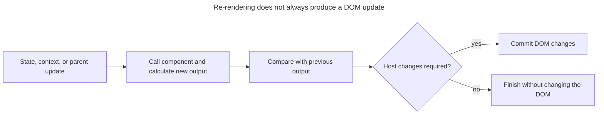

## TL;DR

A re-render means React calls a function component again (or calls a class component's `render`) to compute a new element description. State updates, context changes, or a parent rendering can trigger it. React then reconciles the result with the previous tree. Re-rendering is not the same as updating the DOM: if the rendered output is unchanged, the commit may perform no DOM mutations.

---

## What does re-rendering mean in React?

A re-render is React calling a component again to calculate its next output; it is distinct from committing changes to the host environment.

### Understanding re-rendering

Re-rendering is the process by which React calls a component's function again to compute a new UI description. It does not necessarily result in a DOM update: reconciliation may determine that no host changes are required.

### When does re-rendering occur?

Re-rendering occurs in the following scenarios:

- When a state update from a `useState` setter or `useReducer` dispatch is not skipped by a same-value bailout
- When a component subscribed to a context reads a new context value
- When a parent component re-renders, its children render by default—even if their props are referentially unchanged—unless an applicable bailout skips them
- When a component's `key` changes, React unmounts the old instance and mounts a new one (a remount, not just a re-render)

### The re-rendering process

React moves from a scheduled update through render and reconciliation before committing any required host changes:

1. **Trigger**: A state update, context value change, or parent re-render schedules the component for re-rendering.
2. **Render**: React calls the component function again to produce a new React element tree.
3. **Reconciliation**: React diffs the new tree against the previous one.
4. **Commit**: React applies the required changes (if any) to the actual DOM.

The render and commit phases are separate, so calling a component again does not imply that React will mutate the DOM:



### Example

Here's a simple example to illustrate re-rendering:

```jsx
import { useState } from 'react';

function Counter() {
  const [count, setCount] = useState(0);

  return (
    <div>
      <p>Count: {count}</p>
      <button onClick={() => setCount(count + 1)}>Increment</button>
    </div>
  );
}
```

In this example:

- The `Counter` component has a state variable `count`.
- When the button is clicked, `setCount` updates the state, triggering a re-render.
- React calls the `Counter` function again, producing a new element tree that is reconciled against the previous one.
- React updates the actual DOM to reflect the new count.

### Performance considerations

The cost of a re-render depends on the component work and subtree size. Profile a slow interaction before adding memoization. Common ways to narrow measured render work include:

- **`memo`**: Lets React skip a prop-driven render when each prop compares equal to its previous value with `Object.is` (unless a custom comparator is provided). The component still renders for its own state or a context value it reads.
- **`useMemo` and `useCallback`**: Hooks that preserve the identity of values and functions across renders so memoized children don't see "new" props.
- **State colocation**: Move state down so fewer components re-render when it changes.

### React Compiler

React Compiler 1.0 is an optional build-time optimizer. When enabled, it memoizes compatible components and values and can remove much of the need for manual `memo`, `useMemo`, and `useCallback`. It is not part of React's runtime, does not optimize code it cannot prove safe, and does not eliminate re-renders caused by a component's own state or a context value it reads changing.

## Further reading

- [React documentation on rendering](https://react.dev/learn/render-and-commit)
- [React documentation on state](https://react.dev/learn/state-a-components-memory)
- [React.memo](https://react.dev/reference/react/memo)
