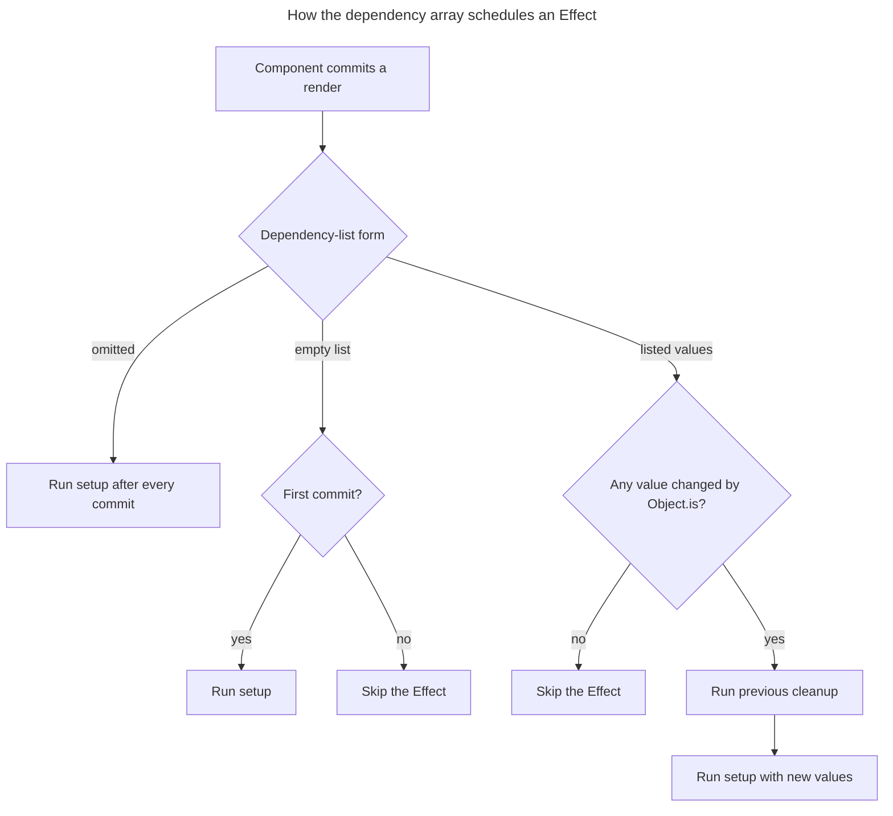

## TL;DR

The dependency array of `useEffect` controls when React re-synchronizes the effect. With no array, React runs setup after every commit. With `[]`, it runs setup after the component mounts (development Strict Mode immediately performs an extra setup/cleanup cycle). With dependencies, it runs after mount and again whenever any dependency changes according to `Object.is`. Cleanup runs before re-synchronization and after unmounting.

---

## What does the dependency array of `useEffect` affect?

The dependency list controls when React re-synchronizes an Effect with the reactive values used by its setup function.

### Introduction to `useEffect`

The `useEffect` hook in React is used to perform side effects in functional components. These side effects can include data fetching, subscriptions, or manually changing the DOM. The `useEffect` hook takes two arguments: a function that contains the side effect logic and an optional dependency array.

### Dependency array

The dependency array is the second argument to the `useEffect` hook. It is an array of values that the effect depends on. React uses this array to determine when to re-run the effect.

```javascript
useEffect(() => {
  // Side effect logic here
}, [dependency1, dependency2]);
```

### How the dependency array affects `useEffect`

The three common dependency-list forms produce different setup and cleanup schedules:

1. **Empty dependency array (`[]`)**:
   - The effect runs once after the initial render and its cleanup runs once on unmount.
   - This is roughly analogous to `componentDidMount` plus `componentWillUnmount`, but with an important caveat: at a Strict Mode root in development, React performs an extra Effect setup-and-cleanup cycle before the real setup. This stress-tests cleanup without representing a second production mount.

   ```javascript
   useEffect(() => {
     // This code runs after the initial render
     return () => {
       // Cleanup runs on unmount
     };
   }, []);
   ```

2. **Dependency array with variables**:
   - The effect runs after the initial render and whenever any of the specified dependencies change.
   - React compares each dependency with its previous value using `Object.is` (reference equality, not a deep or shallow object comparison). Inline objects, arrays, or functions therefore change identity on every render unless memoized.

   ```javascript
   useEffect(() => {
     // This code runs after the initial render and whenever dependency1 or dependency2 changes
   }, [dependency1, dependency2]);
   ```

3. **No dependency array**:
   - The effect runs after every render.
   - This can lead to performance issues if the effect is expensive.

   ```javascript
   useEffect(() => {
     // This code runs after every render
   });
   ```

The dependency-list form selects the schedule, while a changed dependency also determines when cleanup must precede the next setup:



### Cleanup behavior on dependency change

When dependencies change, React first runs the previous effect's cleanup function (if any) before running the effect again with the new values. The same is true on unmount. This means dependency changes effectively perform a tear-down/set-up cycle, which matters for subscriptions, intervals, and event listeners.

```javascript
useEffect(() => {
  const subscription = source.subscribe(id);
  return () => subscription.unsubscribe(); // runs before next effect or on unmount
}, [id]);
```

### The `react-hooks/exhaustive-deps` lint rule

The official `eslint-plugin-react-hooks` ships an `exhaustive-deps` rule that warns when reactive values used inside an effect are missing from the dependency array. Treat its warnings as bugs — silencing the rule is almost always the wrong fix and a common source of stale closures.

### Common pitfalls

Incorrect dependencies either leave an Effect synchronized with stale values or cause unnecessary repeated setup:

1. **Stale closures**:
   - If you use state or props inside the effect without including them in the dependency array, you might end up with stale values.
   - Always include all state and props that the effect depends on in the dependency array.

   ```javascript
   const [count, setCount] = useState(0);

   useEffect(() => {
     const handle = setInterval(() => {
       console.log(count); // This might log stale values if `count` is not in the dependency array
     }, 1000);

     return () => clearInterval(handle);
   }, [count]); // Ensure `count` is included in the dependency array
   ```

   React 19.2 introduced the stable `useEffectEvent` API for logic that is conceptually an event fired by an Effect. It can read the latest committed props and state without making the surrounding Effect re-synchronize:

   ```javascript
   const onTick = useEffectEvent(() => {
     console.log(count); // always reads the latest count
   });

   useEffect(() => {
     const handle = setInterval(onTick, 1000);
     return () => clearInterval(handle);
   }, []); // effect does not need `count` in its deps
   ```

   Effect Events are not a general way to suppress dependencies: declare them in the same component or custom Hook as their Effect, call them only from Effects or other Effect Events, and do not include them in dependency arrays. `eslint-plugin-react-hooks` v6.1.1 or newer enforces these restrictions.

2. **Functions as dependencies**:
   - Functions are recreated on every render, so including them in the dependency array can cause the effect to run more often than necessary.
   - Use `useCallback` to memoize functions if they need to be included in the dependency array.

   ```javascript
   const handleClick = useCallback(() => {
     console.log('clicked');
   }, []);

   useEffect(() => {
     window.addEventListener('click', handleClick);
     return () => window.removeEventListener('click', handleClick);
   }, [handleClick]); // stable identity, so this effect does not re-subscribe each render
   ```

## Further reading

- [React Docs: Using the Effect Hook](https://react.dev/reference/react/useEffect)
- [React Docs: Rules of Hooks](https://react.dev/reference/rules/rules-of-hooks)
- [React Docs: `useEffectEvent`](https://react.dev/reference/react/useEffectEvent)
- [Overreacted: A Complete Guide to useEffect](https://overreacted.io/a-complete-guide-to-useeffect/)
