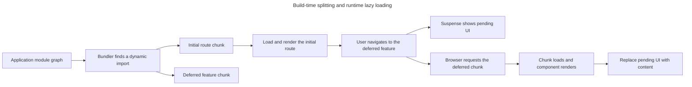

## TL;DR

Code splitting in a React application is a technique used to improve performance by splitting the code into smaller chunks that can be loaded on demand. This helps in reducing the initial load time of the application. You can achieve code splitting using dynamic `import()` statements or React's `React.lazy` and `Suspense`.

```jsx
import { lazy, Suspense } from 'react';

const LazyComponent = lazy(() => import('./LazyComponent'));

function App() {
  return (
    <Suspense fallback={<div>Loading...</div>}>
      <LazyComponent />
    </Suspense>
  );
}
```

---

## What is code splitting in a React application?

Code splitting creates separately loadable JavaScript chunks so a route or feature does not have to ship in the initial bundle.

### Introduction

Code splitting moves route- or feature-specific modules into separately loadable chunks. It can reduce the JavaScript downloaded, parsed, and executed for the initial route when deferred chunks are not immediately needed. Each split also adds a request and a possible loading state, so choose boundaries based on bundle analysis and real navigation behavior.

The build creates the boundary, and the runtime fetches the deferred chunk only when navigation or rendering reaches it:



### How to implement code splitting

Split points can be introduced directly with dynamic imports or through React and framework conventions built on them.

#### Using dynamic `import()`

Dynamic `import()` is a JavaScript feature that allows you to load modules asynchronously. This can be used to split your code into separate chunks.

```javascript
async function formatReport(data) {
  const { formatReportRows } = await import('./report-formatters');
  return formatReportRows(data);
}
```

#### Using `lazy` and `Suspense`

React provides built-in support for code splitting through `lazy` and `Suspense`. `lazy` lets you render a dynamic import as a regular component, and `Suspense` lets you specify a loading fallback while the chunk is being fetched.

```jsx
import { lazy, Suspense } from 'react';

const LazyComponent = lazy(() => import('./LazyComponent'));

function App() {
  return (
    <Suspense fallback={<div>Loading...</div>}>
      <LazyComponent />
    </Suspense>
  );
}
```

#### Route-based splitting

The dominant real-world use case is splitting at route boundaries — each route loads its own chunk so users only download the code for the page they visit. With React Router this is typically:

```jsx
import { lazy, Suspense } from 'react';
import { Routes, Route } from 'react-router';

const Dashboard = lazy(() => import('./pages/Dashboard'));
const Settings = lazy(() => import('./pages/Settings'));

function App() {
  return (
    <Suspense fallback={<div>Loading...</div>}>
      <Routes>
        <Route path="/dashboard" element={<Dashboard />} />
        <Route path="/settings" element={<Settings />} />
      </Routes>
    </Suspense>
  );
}
```

#### Framework-level splitting

React frameworks usually provide route-level code splitting and preloading conventions. For example, the Next.js App Router automatically splits application code by route segments, while React Router framework mode creates route chunks according to its build configuration. Follow the framework's current guidance before adding `lazy` around routes yourself; `lazy` remains useful for optional client-only features such as editors, charts, and rarely opened dialogs.

#### Pairing `Suspense` with error boundaries

`Suspense` only handles the loading state. If the dynamic import fails because of a network error or deploy mismatch, an error boundary can render a failure fallback. This example uses the third-party `react-error-boundary` package:

```jsx
import { ErrorBoundary } from 'react-error-boundary';

function Feature() {
  return (
    <ErrorBoundary fallback={<p>Could not load this feature.</p>}>
      <Suspense fallback={<p>Loading...</p>}>
        <LazyComponent />
      </Suspense>
    </ErrorBoundary>
  );
}
```

#### `Suspense` for data and `use()`

In React 19, a component can read a cached promise with the special `use` API and suspend at the same boundary used by `lazy`. The promise should come from a Suspense-enabled framework or cache rather than being recreated during render. A single `<Suspense>` boundary can then coordinate supported code and data dependencies.

#### Preloading

With a bundler that caches the same dynamic import, an application can start loading a lazy chunk before it is needed, such as on hover or keyboard focus:

```jsx
const Editor = lazy(() => import('./Editor'));

function preloadEditor() {
  void import('./Editor');
}

function OpenButton() {
  return (
    <button
      onFocus={preloadEditor}
      onMouseEnter={preloadEditor}
      onClick={openEditor}>
      Open editor
    </button>
  );
}
```

### Benefits of code splitting

Useful split points reduce initial work without fragmenting the application into excessive requests and loading states.

- **Improved performance**: By loading only the necessary code initially, you can reduce the initial load time of your application.
- **Less initial JavaScript**: Route or feature chunks can keep unrelated code out of the initial download and execution path.
- **Tradeoff control**: Choosing useful split points balances initial bundle size against extra requests and loading fallbacks.

### Tools and libraries

Chunk creation and loading behavior ultimately depend on the application's bundler or framework:

- **Webpack / Rspack / Vite / Turbopack**: These bundlers can create chunks at dynamic `import()` boundaries; exact chunking and preloading behavior depends on configuration and framework integration.
- **React Loadable**: A predecessor to `React.lazy` that is now abandoned (unmaintained for years). New code should use `lazy` and `Suspense` instead.

## Further reading

- [React documentation on `lazy`](https://react.dev/reference/react/lazy)
- [React documentation on `Suspense`](https://react.dev/reference/react/Suspense)
- [React documentation on `use`](https://react.dev/reference/react/use)
- [Webpack documentation on code splitting](https://webpack.js.org/guides/code-splitting/)
- [MDN Web Docs on dynamic import](https://developer.mozilla.org/en-US/docs/Web/JavaScript/Reference/Statements/import#dynamic_imports)
