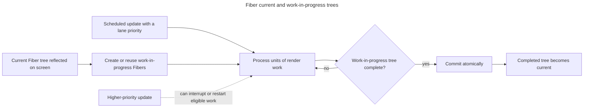

## TL;DR

Fiber is React's internal reconciliation architecture, introduced in React 16. A Fiber represents a unit of work and links to related Fibers in the component tree. This structure lets React assign priorities, pause or abandon interruptible renders, and commit completed work separately. It is the foundation for concurrent features such as transitions and Suspense, but it does not make every update asynchronous or guarantee that expensive rendering will be fast.

---

## What is React Fiber and how is it an improvement over the previous approach?

Fiber is React's internal work representation, designed so eligible rendering can be scheduled, paused, resumed, or abandoned before commit.

### Introduction to React Fiber

React Fiber is a re-implementation of React's core rendering and reconciliation algorithm. It was introduced in React 16 to replace the previous stack-based traversal with units of work that React can prioritize and, for eligible concurrent renders, pause or abandon before commit.

### Key improvements over the previous approach

The architecture separates units of render work and assigns them scheduling information, enabling several capabilities:

#### Incremental rendering

The previous stack-based reconciler processed an update in a single synchronous traversal. Fiber represents the traversal as units that React can schedule separately. For interruptible work, React can yield to the browser, resume later, or abandon a stale render. Synchronous work and expensive component calculations can still block the main thread.

#### Time slicing

Time slicing is the ability to perform eligible rendering work incrementally and yield so the browser can process higher-priority work. React's scheduler decides when to continue; it is not simply tied to the next idle frame. Applications expose non-urgent work through APIs such as transitions and `useDeferredValue`.

#### Prioritization with lanes and transitions

Separate from time slicing is the question of _which_ work to do first. In React 18+, Fiber uses a "lanes" model to assign priorities to updates. Urgent updates (such as input or click handlers) run on high-priority lanes, while updates wrapped in `startTransition` or coming from `useDeferredValue` run on lower-priority lanes that can be interrupted by more urgent work.

#### Double-buffered work-in-progress trees

Fiber maintains two trees: the "current" tree that reflects what's on screen, and a "work-in-progress" tree that React builds in memory. Because the new tree is constructed off-screen, React can pause, throw away, or restart the work-in-progress tree without ever showing a half-rendered UI to the user. The two trees swap atomically once the commit phase completes.

Double buffering lets React keep the visible tree stable while it schedules work on a separate candidate tree:



#### Concurrent rendering APIs

`createRoot` is the current client root API; the legacy `ReactDOM.render` API was removed in React 19. Concurrent rendering is an internal capability that React applies when a feature such as a transition or Suspense needs it. It is not a mode in which every update is automatically deferred: urgent updates remain synchronous from the user's point of view, and React commits only a completed tree.

#### Error boundaries

Error boundaries let components catch render-time errors in their subtree and show a fallback UI instead of crashing the whole app. They were introduced as a public React 16 API alongside Fiber, but they're conceptually independent of the Fiber scheduler — error boundaries are about error containment, not about how work is scheduled.

#### Owner stacks (React 19.1)

React 19.1 added owner stacks in development. They trace the components that created an element by following Fiber owner relationships rather than relying only on JavaScript call stacks, which identifies the component creation path for an error or warning.

#### Improved support for animations

Fiber can keep urgent input responsive while lower-priority React rendering is in progress. It does not schedule or guarantee smooth CSS/JavaScript animation frames; application code must still avoid expensive synchronous work and use appropriate browser animation APIs.

### Code example

Here's a simple example showing how to opt into Fiber's concurrent rendering for a large list:

```jsx
import { useState, useTransition } from 'react';

function BigList() {
  const [items, setItems] = useState([]);
  const [isPending, startTransition] = useTransition();

  function loadItems() {
    startTransition(() => {
      setItems(Array.from({ length: 10000 }, (_, i) => i));
    });
  }

  return (
    <div>
      <button onClick={loadItems}>Load items</button>
      {isPending && <p>Loading…</p>}
      {items.map((item) => (
        <div key={item}>{item}</div>
      ))}
    </div>
  );
}
```

A synchronous render of 10,000 items can still block the main thread; Fiber does not time-slice every update. Concurrent features such as `startTransition`, `useDeferredValue`, and `Suspense` let React treat eligible rendering as interruptible. Marking this update as a Transition lets React yield during render for urgent updates, although creating the array and committing thousands of DOM nodes still have synchronous costs.

## Further reading

- [React Fiber Architecture](https://github.com/acdlite/react-fiber-architecture)
- [React Blog: Concurrent Features](https://react.dev/blog/2022/03/29/react-v18#gradually-adopting-concurrent-features)
- [React 19 release notes](https://react.dev/blog/2024/12/05/react-19)
