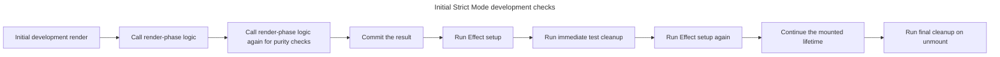

## TL;DR

`<StrictMode>` enables development-only checks for a React subtree. React renders components an extra time to expose impure rendering, runs an extra setup-and-cleanup cycle for Effects, re-runs ref callbacks, and checks for deprecated APIs. It renders no UI and adds no production behavior. The extra work is a stress test: fix the missing cleanup or impurity instead of trying to suppress it.

---

## What is React Strict Mode and what are its benefits?

Strict Mode enables development-only checks that expose rendering impurities, missing Effect cleanup, and deprecated API usage.

### What is React Strict Mode?

React strict mode is a feature in React that helps developers identify potential problems in their applications. It is a wrapper component that you can use to wrap parts of your application to enable additional checks and warnings. It does not render any visible UI and does not affect the production build.

To use React strict mode, you can wrap your component tree with the `StrictMode` component:

```jsx
import { StrictMode } from 'react';
import { createRoot } from 'react-dom/client';
import App from './App';

const root = createRoot(document.getElementById('root'));
root.render(
  <StrictMode>
    <App />
  </StrictMode>,
);
```

Some frameworks enable Strict Mode for you. Check the framework and router version rather than assuming it is active; otherwise add `<StrictMode>` at the root or around the subtree you want to check.

### Benefits of React Strict Mode

Its extra development executions are diagnostics that make assumptions about purity and cleanup fail earlier.

#### Detecting unexpected side effects (the headline behavior)

In development, Strict Mode performs extra checks including:

- Rendering function components (and selected class methods) an extra time
- Calling functions that should be pure, such as state initializer/updater functions, reducers, and `useMemo` calculations, an extra time
- Running one extra Effect setup-and-cleanup cycle
- Running one extra ref-callback setup-and-cleanup cycle

The Effect check is a common interview topic. It surfaces Effects that are not safely re-synchronized—for example, an Effect that subscribes but does not unsubscribe in cleanup. React is stress-testing the Effect's setup/cleanup contract; it is not performing a second production mount.

These checks apply only in development. If `<StrictMode>` is not enabled at the root, React does not run the initial extra Effect cycle for a nested boundary because that parent/child sequence could not happen in production.

At a Strict Mode root, the initial development sequence deliberately repeats pure work and immediately verifies that Effect cleanup reverses setup:



#### Warning about legacy and deprecated APIs

StrictMode warns about APIs that are no longer recommended, including:

- The legacy string ref API (use `useRef` instead — that's the modern default in function components)
- Use of `findDOMNode`
- Deprecated context APIs

#### Surfacing unsafe class lifecycle methods

In legacy class components, StrictMode flags `componentWillMount`, `componentWillReceiveProps`, and `componentWillUpdate` as unsafe. This matters less today since most new code uses function components, but it's still relevant if you're maintaining a class-based codebase.

#### Ensuring components are resilient to future changes

The additional checks make it easier to spot components that quietly depend on a single mount or hidden side effects, so your codebase stays compatible as React adds features that may mount, unmount, and remount components more aggressively.

## Further reading

- [React Strict Mode Documentation](https://react.dev/reference/react/StrictMode)
- [React Lifecycle Methods](https://react.dev/reference/react/Component#adding-lifecycle-methods-to-a-class-component)
- [Refs and the DOM](https://react.dev/learn/manipulating-the-dom-with-refs)
