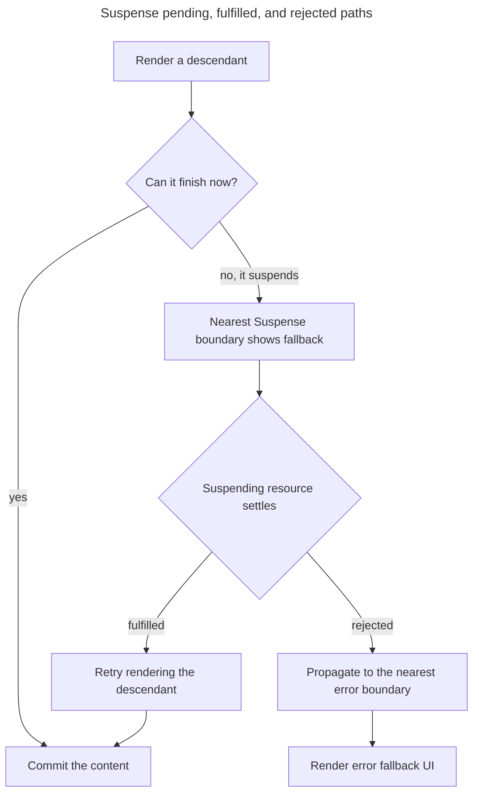

## TL;DR

`Suspense` lets React display a fallback while a descendant is not ready to render. Supported sources include code loaded with `lazy`, cached promises read with React 19's `use` API, React Server Components, and Suspense-enabled framework or library integrations. Suspense coordinates pending UI; an error boundary is still needed for rejected promises, and arbitrary asynchronous work does not activate Suspense automatically.

```jsx
const LazyComponent = React.lazy(() => import('./LazyComponent'));

function MyComponent() {
  return (
    <React.Suspense fallback={<div>Loading...</div>}>
      <LazyComponent />
    </React.Suspense>
  );
}
```

---

## What is React Suspense and what does it enable?

Suspense coordinates how a boundary responds when a supported descendant cannot finish the current render yet.

### Introduction to React Suspense

React Suspense coordinates a fallback for a subtree that cannot finish rendering yet. A component must suspend through a React-supported mechanism—such as `lazy`, `use` with a cached promise, or a framework integration. Starting a request in an Effect or returning a promise from an event handler does not make the nearest boundary show its fallback.

The nearest Suspense boundary owns the pending path, while rejection follows the normal error-boundary path:



### Code splitting with React.lazy

One primary Suspense use case is code splitting. Loading a component's chunk only when that component is needed can reduce initial JavaScript, while the boundary provides pending UI for the chunk request.

```jsx
import React, { Suspense } from 'react';

const LazyComponent = React.lazy(() => import('./LazyComponent'));

function MyComponent() {
  return (
    <Suspense fallback={<div>Loading...</div>}>
      <LazyComponent />
    </Suspense>
  );
}
```

In this example, `React.lazy` is used to dynamically import the `LazyComponent`. The `Suspense` component wraps the lazy-loaded component and provides a fallback UI (`<div>Loading...</div>`) to display while the component is being loaded.

### Data fetching with Suspense

React 19 stabilized reading cached promises with `use`. Supported data-loading paths include React Server Components, promises passed to Client Components and read with `use`, and Suspense-aware integrations such as TanStack Query or Relay. A plain query API does not necessarily suspend; use the library's documented Suspense integration. Promises created during a Client Component render must be cached or React will repeatedly suspend on a new promise.

```jsx
import { Suspense } from 'react';
import { useSuspenseQuery } from '@tanstack/react-query';

function fetchData() {
  return fetch('https://api.example.com/data').then((response) => {
    if (!response.ok) throw new Error(`HTTP ${response.status}`);
    return response.json();
  });
}

function DataComponent() {
  // useSuspenseQuery throws a promise while loading,
  // which Suspense catches and shows the fallback for.
  const { data } = useSuspenseQuery({
    queryKey: ['data'],
    queryFn: fetchData,
  });
  return <pre>{JSON.stringify(data, null, 2)}</pre>;
}

function MyComponent() {
  return (
    <Suspense fallback={<div>Loading data...</div>}>
      <DataComponent />
    </Suspense>
  );
}
```

### The `use` API (React 19)

In React 19, you can read a promise directly from a client component with the `use()` hook. While the promise is pending, React suspends the nearest `Suspense` boundary; when it resolves, the component re-renders with the value.

```jsx
import { Suspense, use } from 'react';

function Profile({ userPromise }) {
  const user = use(userPromise);
  return <h1>{user.name}</h1>;
}

function Page({ userPromise }) {
  return (
    <Suspense fallback={<p>Loading profile…</p>}>
      <Profile userPromise={userPromise} />
    </Suspense>
  );
}
```

`use()` also reads context. Despite its name, it is not a Hook: it can be called inside conditionals and loops, but it must run inside a component or Hook and cannot be wrapped in `try`/`catch`.

### Server Components and streaming SSR

React Server Components can suspend on the server while data loads, and the framework streams HTML to the browser as each `Suspense` boundary resolves. This means users see content progressively instead of waiting for the entire page to be ready, with the same `<Suspense fallback={...}>` semantics on both server and client.

React 19.2 batches the reveal of server-rendered Suspense boundaries for a short period so nearby content can appear together. React uses heuristics to avoid delaying important loading metrics.

### Pairing Suspense with error boundaries

Suspense handles the _pending_ state of an async operation, but it doesn't handle the _error_ state. To cover both, wrap your suspending tree in an error boundary as well:

```jsx
import { Suspense } from 'react';
import { ErrorBoundary } from 'react-error-boundary';

function DataPanel() {
  return (
    <ErrorBoundary fallback={<p>Something went wrong.</p>}>
      <Suspense fallback={<p>Loading…</p>}>
        <DataComponent />
      </Suspense>
    </ErrorBoundary>
  );
}
```

### Benefits of React Suspense

Suspense centralizes pending UI for supported code and data sources and composes with streaming rendering.

- **Coordinated pending UI**: One boundary can keep already revealed content visible or replace a pending subtree with a deliberate fallback.
- **Boundary-level loading states**: Suspense-aware code and data sources can avoid threading an `isLoading` flag through every component in the subtree.
- **Progressive delivery**: `lazy` enables bundler-backed code splitting, while streaming SSR can send completed boundaries without waiting for the entire page.

## Further reading

- [React Suspense documentation](https://react.dev/reference/react/Suspense)
- [React 19.2 release notes](https://react.dev/blog/2025/10/01/react-19-2)
- [React.lazy documentation](https://react.dev/reference/react/lazy)
- [`use` API reference](https://react.dev/reference/react/use)
- [TanStack Query documentation](https://tanstack.com/query)
- [Relay Suspense documentation](https://relay.dev/docs/next/guides/relay-resolvers/suspense/)
