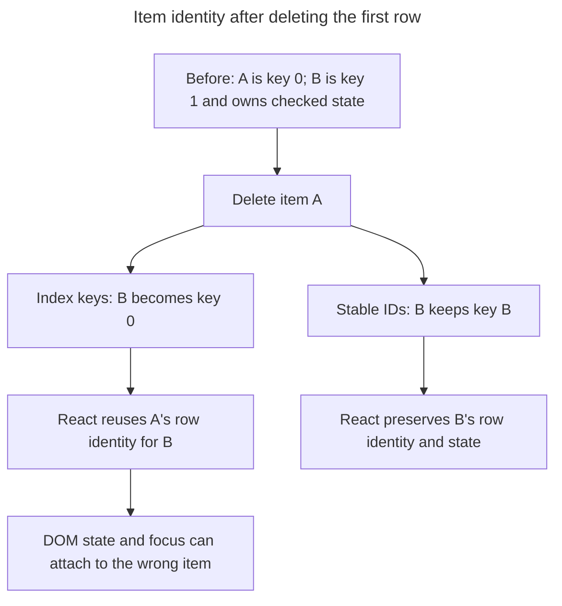

## TL;DR

Using array indices as `key`s causes React to reconcile the list incorrectly when items are reordered, inserted, or removed. Because the key identifies a position rather than an item, React reuses the wrong component instances — leaving stale local state, focus, and DOM attached to the wrong rows. The fix is to use a stable, unique identifier from the data (e.g. `item.id`). Index keys are only safe when the list is static and never reordered, filtered, or prepended to.

---

## Consequence of using array indices as the value for `key`s in React

An index identifies a list position rather than the logical item occupying it, which breaks identity when the list changes before that position.

### Incorrect reconciliation, not just "slow renders"

The real problem is correctness, not performance. React's `key` is the identity React uses to match an element across renders. When the key is the array index, the identity tracks the **slot** in the array rather than the **item** in the slot. After a reorder, insert, or delete, React still matches `key={0}` to `key={0}`, so it:

- Keeps the same component instance mounted for what is now a different item.
- Preserves local `useState`, refs, focus, scroll position, and uncontrolled input values on the wrong row.
- Skips bailouts it would otherwise hit, because props for the reused instance changed.

In other words, the bug is "state and DOM tied to the wrong items." Re-render cost is a secondary consequence.

### The classic input/checkbox state-bleed bug

This is the canonical demonstration. Each row owns an uncontrolled `<input>`; the user types into the second one, then the list is reordered or the first item is deleted.

```jsx
function TodoList({ todos, onDelete }) {
  return (
    <ul>
      {todos.map((todo, index) => (
        // Bug: key is the index
        <li key={index}>
          <input type="checkbox" defaultChecked={todo.done} />
          <input type="text" defaultValue={todo.title} />
          <button onClick={() => onDelete(todo.id)}>Delete</button>
        </li>
      ))}
    </ul>
  );
}
```

If the user checks the second row and then deletes the first row, React reuses the old `<li key={0}>` for the item that moved into index `0`. That item therefore inherits the first row's uncontrolled DOM state. The checked DOM from the old `<li key={1}>` either moves to the item now at index `1` or disappears if no row remains there. Switching to `key={todo.id}` fixes the mismatch because React removes only the deleted item's row and preserves each surviving item's DOM with that item.

The two key strategies give React different answers about which row survived the deletion:



### When index keys are acceptable

Index keys are fine when **all** of the following hold:

- The list is static (never reordered or filtered).
- Items are never inserted or removed from anywhere except the end.
- Each item has no per-row state, focus, or uncontrolled input that could leak.

A render-once nav menu built from a constant array fits. A live, editable, sortable, or paginated list does not.

### Omitting the `key` is even worse

If you leave `key` off entirely, React falls back to using the index and prints a `Warning: Each child in a list should have a unique "key" prop` in development. Suppressing the warning by passing `key={index}` does not fix the underlying issue — it just hides the message.

### Better approach

Use a stable id that comes from the data, not from the render position.

```jsx
const items = [
  { id: 'a1', name: 'Item 1' },
  { id: 'b2', name: 'Item 2' },
  { id: 'c3', name: 'Item 3' },
];

const List = () => (
  <ul>
    {items.map((item) => (
      <li key={item.id}>{item.name}</li>
    ))}
  </ul>
);
```

If the data has no natural id, generate one when the item is created (e.g. `crypto.randomUUID()`) and store it on the item — do not generate a fresh id inside `map`, because it would change every render and defeat reconciliation entirely.

## Further reading

- [React documentation on keys](https://react.dev/learn/rendering-lists#why-does-react-need-keys)
- [React documentation: keeping list items in order with `key`](https://react.dev/learn/rendering-lists#keeping-list-items-in-order-with-key)
- [React performance optimization with keys](https://kentcdodds.com/blog/understanding-reacts-key-prop)
