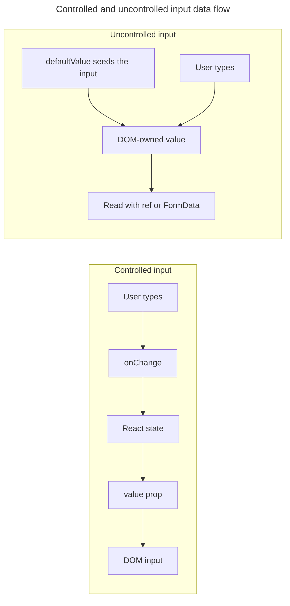

## TL;DR

A **controlled** component drives a form input from React state — you pass `value`/`checked` plus an `onChange` handler, and React state is the single source of truth. An **uncontrolled** component lets the DOM keep the value; you read it via a `ref` (or on submit) and seed the initial value with `defaultValue`/`defaultChecked`. Controlled inputs are the right default when you need validation, conditional UI, or to derive other state from the value. Uncontrolled inputs are simpler for write-once forms and for `<input type="file">`, which is always uncontrolled. React 19 also added first-class form support via the form `action` prop, `useFormStatus`, and `useActionState`, which often removes the need for per-field controlled state.

---

## What is the difference between controlled and uncontrolled React components?

The distinction is which system owns the current form value: React state for a controlled input or the DOM for an uncontrolled input.

### Controlled components

A controlled input passes both `value` (or `checked`) and `onChange` to the element. React state holds the truth; every keystroke flows through a setter.

```jsx
import { useState } from 'react';

function ControlledForm() {
  const [name, setName] = useState('');

  function handleSubmit(event) {
    event.preventDefault();
    alert('A name was submitted: ' + name);
  }

  return (
    <form onSubmit={handleSubmit}>
      <label>
        Name:
        <input
          type="text"
          value={name}
          onChange={(event) => setName(event.target.value)}
        />
      </label>
      <input type="submit" value="Submit" />
    </form>
  );
}
```

### Uncontrolled components

An uncontrolled input keeps its value in the DOM. Seed the initial value with `defaultValue` (or `defaultChecked` for checkboxes/radios), and read the current value through a `ref` when you need it.

```jsx
import { useRef } from 'react';

function UncontrolledForm() {
  const inputRef = useRef(null);

  function handleSubmit(event) {
    event.preventDefault();
    alert('A name was submitted: ' + inputRef.current.value);
  }

  return (
    <form onSubmit={handleSubmit}>
      <label>
        Name:
        <input type="text" defaultValue="" ref={inputRef} />
      </label>
      <input type="submit" value="Submit" />
    </form>
  );
}
```

`defaultValue` is only consulted on the initial render — changing it later does not update the DOM. Passing `value` without an `onChange` handler makes the input read-only and warns in development unless `readOnly` is intentional. The reverse is valid: an input with `onChange` but no `value` remains uncontrolled. Pick one mode per field and do not switch modes during the input's lifetime.

### `<input type="file">` is always uncontrolled

File inputs cannot be controlled — their `value` is read-only for security reasons (a page must not be able to set the user's chosen file). Always read files via a `ref` or from the `change`/`submit` event, even in an otherwise controlled form.

```jsx
function FileForm() {
  const fileRef = useRef(null);

  function handleSubmit(event) {
    event.preventDefault();
    const file = fileRef.current.files[0];
    // upload file...
  }

  return (
    <form onSubmit={handleSubmit}>
      <input type="file" ref={fileRef} />
      <button type="submit">Upload</button>
    </form>
  );
}
```

### React 19 form actions

React 19 made `<form action={...}>` a first-class way to handle submissions without per-field controlled state. The action receives a `FormData` object, and `useFormStatus` / `useActionState` expose pending and result state.

```jsx
import { useActionState } from 'react';
import { useFormStatus } from 'react-dom';

function SubmitButton() {
  const { pending } = useFormStatus();
  return <button disabled={pending}>{pending ? 'Saving...' : 'Save'}</button>;
}

async function saveName(_previousState, formData) {
  const name = String(formData.get('name') ?? '');
  const response = await fetch('/api/profile', {
    method: 'POST',
    body: formData,
  });
  if (!response.ok) return { ok: false, error: 'Could not save name.' };
  return { ok: true, name };
}

function NameForm() {
  const [state, formAction] = useActionState(saveName, null);
  return (
    <form action={formAction}>
      <input name="name" defaultValue={state?.name ?? ''} />
      <SubmitButton />
      {state?.error && <p role="alert">{state.error}</p>}
    </form>
  );
}
```

This pattern uses uncontrolled inputs (`defaultValue` plus `name`) and reads them out of `FormData` in the action — often the simplest choice for plain submit-style forms.

### Key differences

The ownership choice changes how values update and which use cases each style fits.

#### State management

Controlled and uncontrolled inputs store their current value in different places:

- Controlled: React state owns the value; the DOM mirrors it.
- Uncontrolled: The DOM owns the value; React reads it on demand.

#### Data flow

Both styles can report changes, but only the controlled style feeds every rendered value back through React state:

- Controlled: `state -> value -> input`, and `onChange -> setState`.
- Uncontrolled: `defaultValue -> input`, then `ref.current.value` (or `FormData`) when read.

The controlled loop continuously routes the value through React, while the uncontrolled path leaves ongoing ownership in the DOM:



#### When to use which

Choose according to whether application logic must observe or transform each value change:

- Controlled: validation as the user types, conditional disabling, formatting, deriving other state, or anything that needs to react to every keystroke.
- Uncontrolled: simple submit-once forms, integration with non-React code, file inputs, and forms built around React 19 actions.

## Further reading

- [React documentation on `<input>` controlled vs uncontrolled](https://react.dev/reference/react-dom/components/input#controlling-an-input-with-a-state-variable)
- [React documentation on manipulating the DOM with refs](https://react.dev/learn/manipulating-the-dom-with-refs)
- [React documentation on `<form>` with actions](https://react.dev/reference/react-dom/components/form)
- [React documentation on `useActionState`](https://react.dev/reference/react/useActionState)
- [React documentation on `useFormStatus`](https://react.dev/reference/react-dom/hooks/useFormStatus)
