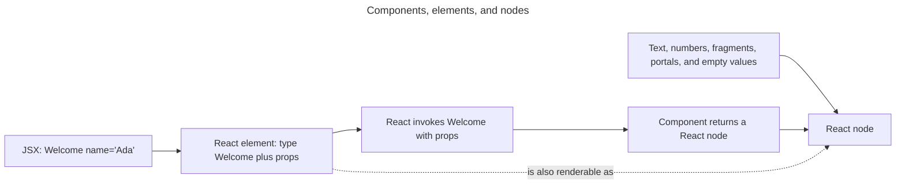

## TL;DR

A **React Node** is a value React can render, including an element, string, number, bigint, iterable of nodes, portal, or an empty value such as `null` or a boolean. React 19's type also supports promises that resolve to renderable nodes in supported rendering environments. A **React Element** is the immutable object produced by JSX or `createElement` that describes what to render. A **React Component** is a function or class React uses as an element type. Components produce nodes; elements are descriptions; nodes are the broader set of renderable values.

---

## React node

A **React Node** is anything that can appear in a JSX child position. The set includes:

- React Elements (e.g. `<div />`, `<MyComponent />`)
- Strings, numbers, and bigints (rendered as text)
- Arrays and other iterables of React Nodes (arrays are commonly produced by `.map(...)`)
- Fragments (`<>...</>` or `<React.Fragment>`)
- Portals (created with `createPortal`)
- Promises of React Nodes in rendering environments that support suspending on them
- `null`, `undefined`, `false`, and `true` — these are valid nodes that **render nothing** (they are skipped, not converted to text)

```jsx
const stringNode = 'Hello, world!';
const numberNode = 123;
const arrayNode = [<li key="a">a</li>, <li key="b">b</li>];
const fragmentNode = (
  <>
    <span>one</span>
    <span>two</span>
  </>
);
const nothingNode = null; // also: undefined, false, true — render nothing
const elementNode = <div>Hello, world!</div>;
```

This is why `condition && <Thing />` works: when `condition` is `false`, the child is just a node that renders nothing.

## React element

A **React Element** is an immutable, plain JavaScript object that describes what should appear on screen. It includes a `type` (a string for host elements like `'div'`, or a component reference), `props` (including `children`), and a `key`. JSX is sugar for `React.createElement` (or, with the modern JSX transform, `react/jsx-runtime`'s `jsx` function), which produces these objects.

```jsx
const element = <div className="greeting">Hello, world!</div>;

// Roughly equivalent to:
const sameElement = React.createElement(
  'div',
  { className: 'greeting' },
  'Hello, world!',
);
```

React elements should be treated as opaque and immutable rather than inspected or modified directly. They are lightweight, short-lived descriptions that React reconciles with the previous output before the renderer commits host changes.

## React component

A **React Component** is a function or class that React can use as an element type. It accepts props and returns React Nodes that describe the UI; an async Server Component may return a promise of a node. Component names are conventionally **PascalCase** so JSX can distinguish them from host elements (`<button>` is a DOM element; `<Button>` is a component).

- **Function components** are the standard form. They are plain functions of `props` that return a node:

  ```jsx
  function Welcome({ name }) {
    return <h1>Hello, {name}</h1>;
  }
  ```

  Hooks (`useState`, `useEffect`, `useMemo`, etc.) cover what used to require a class.

- **Class components** remain supported, but React recommends function components for new code. Legacy lifecycles such as `componentWillMount`, `componentWillReceiveProps`, and `componentWillUpdate` are deprecated, and Hooks are available only in functions.

  ```jsx
  class Welcome extends React.Component {
    render() {
      return <h1>Hello, {this.props.name}</h1>;
    }
  }
  ```

The mental model: a **component** is a recipe, an **element** is a single dish made from that recipe, and a **node** is anything React is willing to plate up — including "nothing."

The relationships are easiest to see by following one component invocation from JSX to renderable output:



## Further reading

- [React documentation: Render and commit](https://react.dev/learn/render-and-commit)
- [React documentation: Passing Props to a Component](https://react.dev/learn/passing-props-to-a-component)
- [React documentation: Writing Markup with JSX](https://react.dev/learn/writing-markup-with-jsx)
- [React documentation: Your First Component](https://react.dev/learn/your-first-component)
