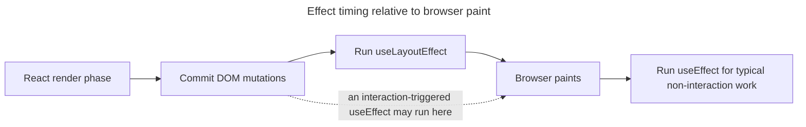

## TL;DR

Both hooks run side effects after render, but they differ in **when** they fire relative to paint:

- `useEffect` runs after React commits. For effects not caused by an interaction, React generally lets the browser paint first; interaction-driven effects may run before paint. Use it for synchronizing with external systems when the work does not need to block paint.
- `useLayoutEffect` runs **synchronously during the commit phase, after DOM mutations but before the browser paints**. It blocks paint, so use it only when you need to measure the DOM and write to it in the same frame to avoid a visual flicker.

Both accept a dependency array with the same semantics. In development Strict Mode, React performs an extra setup-and-cleanup cycle before the real setup. Neither effect runs during server rendering; `useLayoutEffect` is especially unsuitable there because the server has no layout to measure.

Code example:

```jsx
import { useEffect, useLayoutEffect, useRef } from 'react';

function Example() {
  const ref = useRef(null);

  useEffect(() => {
    console.log('useEffect: runs after paint');
  }, []);

  useLayoutEffect(() => {
    console.log('useLayoutEffect: runs before paint');
    console.log('Element width:', ref.current.offsetWidth);
  }, []);

  return <div ref={ref}>Hello</div>;
}
```

---

## What is `useEffect`?

`useEffect` schedules synchronization work after React commits changes to the DOM. If the effect was not caused by an interaction, React generally lets the browser paint first. For interaction-driven effects, React may run it before paint so the event system can observe the result. If timing relative to paint is essential, use the appropriate browser scheduling API or `useLayoutEffect` rather than relying on `useEffect` always running afterward.

- It is the right default for data fetching, subscriptions, event listeners, and logging.
- The dependency array controls when React re-synchronizes: `[a, b]` means after the initial commit and after commits where `a` or `b` changed by `Object.is`; `[]` means after mounting; omitting the array means after every commit.
- In development Strict Mode, React runs one extra setup-and-cleanup cycle before the real setup. This surfaces missing cleanup logic; it is not a production behavior.

### Code example

This Effect synchronizes with an external system after the component commits:

```jsx
import { useEffect } from 'react';

function Example() {
  useEffect(() => {
    console.log('Mounted');
    return () => console.log('Cleanup on unmount');
  }, []); // [] deps: cleanup runs on unmount (plus the Strict Mode stress test in development)

  return <div>Hello, World!</div>;
}
```

In production, cleanup for an Effect with `[]` dependencies runs when the component unmounts. In development Strict Mode, React also performs the extra setup-and-cleanup stress test described above. With non-empty dependencies such as `[userId]`, cleanup runs before the next setup when `userId` changes and again on unmount.

### Common use cases

Use `useEffect` for synchronization that does not need to block the browser's next paint:

- Fetching data from an API
- Setting up subscriptions (e.g., WebSocket connections)
- Logging or analytics tracking
- Adding and removing event listeners that do not affect layout

## What is `useLayoutEffect`?

`useLayoutEffect` runs **synchronously during the commit phase**, after React has written to the DOM but **before the browser paints**. Because it blocks paint, anything you do inside it delays the first visible frame — but in return you can measure the just-committed DOM and make adjustments atomically, with no flicker.

- Use it when you need to read layout (e.g. `getBoundingClientRect`, `offsetWidth`) and then synchronously set state or style so the user never sees the "wrong" frame.
- Keep the body cheap — expensive work here stalls paint.
- Effects do not run during **server rendering**, and `useLayoutEffect` cannot contribute to server HTML because there is no layout to measure. Prefer `useEffect` when the first painted frame can be corrected later. If the content fundamentally depends on layout, render that content only after hydration. Libraries sometimes expose a `useIsomorphicLayoutEffect` alias that selects `useEffect` on the server and `useLayoutEffect` in the browser.

### Code example

This layout Effect measures committed DOM and updates state before the browser paints the result:

```jsx
import { useLayoutEffect, useRef, useState } from 'react';

function Tooltip({ children }) {
  const ref = useRef(null);
  const [height, setHeight] = useState(0);

  useLayoutEffect(() => {
    // Measure and commit the height before the user sees a frame
    setHeight(ref.current.getBoundingClientRect().height);
  }, []);

  return (
    <div ref={ref} style={{ marginTop: -height }}>
      {children}
    </div>
  );
}
```

### Common use cases

Reserve `useLayoutEffect` for layout reads or writes that must complete in the same frame:

- Measuring a DOM node and writing back state/style in the same frame
- Positioning tooltips, popovers, or floating elements based on layout
- Fixing flicker caused by a measure-then-correct pattern

## `useInsertionEffect`

`useInsertionEffect` runs before layout effects so CSS-in-JS libraries can inject `<style>` tags before layout is read. It may run before or after the DOM itself is updated, refs are not attached yet, and it cannot update state. Application code should almost never use it; reach for `useEffect` or `useLayoutEffect` first.

## Dependency arrays and the exhaustive-deps lint rule

Both hooks take a dependency array with the same rules. React compares each entry to the previous render with `Object.is` and re-runs the effect (after running the previous cleanup) when any of them changed. The `react-hooks/exhaustive-deps` ESLint rule flags missing dependencies and is considered required in most React codebases — silencing it usually hides a stale-closure bug. If a value would make the effect re-run too often, the fix is usually to move it inside the effect, memoize it, or convert it to a ref, not to omit it.

## Key differences between `useEffect` and `useLayoutEffect`

The APIs share the same dependency model but run at different points relative to browser paint.

### Timing

The timing distinction determines whether an Effect can delay visible output:

- `useEffect`: Runs after commit and generally after paint for non-interaction effects, but may run before paint when caused by an interaction.
- `useLayoutEffect`: Fires synchronously during commit, **before** the browser paints.

The usual non-interaction timeline puts layout work directly in the commit path and ordinary Effect work after the browser has painted:



### Blocking behavior

Layout Effects run synchronously in the commit path, while ordinary Effects generally allow paint first:

- `useEffect`: Generally does not block paint for non-interaction Effects. Interaction-triggered Effects can run before paint when React needs the result to be observable to the event system.
- `useLayoutEffect`: Blocks paint. The browser cannot repaint until the effect (and any resulting state update) has settled.

### SSR behavior

Neither Effect runs during server rendering, but only the layout variant needs special care because its purpose depends on layout before paint:

- `useEffect`: Skipped on the server (client runs it after hydration).
- `useLayoutEffect`: Does not run on the server; use `useEffect` when possible or render layout-dependent content only after hydration so the server and initial client output still match.

### Use case examples

Choose the least blocking API that still satisfies the synchronization requirement:

- `useEffect`: fetching data, subscriptions, logging, most event listeners.
- `useLayoutEffect`: measuring and adjusting the DOM in the same frame to prevent flicker.

## Further reading

- [React documentation: `useEffect`](https://react.dev/reference/react/useEffect)
- [React documentation: `useLayoutEffect`](https://react.dev/reference/react/useLayoutEffect)
- [React documentation: `useInsertionEffect`](https://react.dev/reference/react/useInsertionEffect)
- [React documentation: You might not need an effect](https://react.dev/learn/you-might-not-need-an-effect)
- [Differences between `useEffect` and `useLayoutEffect`](https://kentcdodds.com/blog/useeffect-vs-uselayouteffect)
