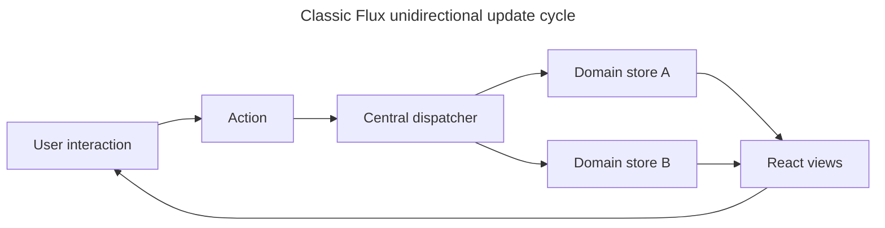

## TL;DR

Flux is a historical application architecture Facebook introduced for managing state around React. An action goes through a central dispatcher to registered stores; stores update their own domain state, emit changes, and views render the new state. This unidirectional flow makes the source of an update easier to trace and separates event creation, state transitions, and rendering. The original Flux library is archived, and modern applications usually choose reducers, external stores, or server-state caches according to their needs rather than implementing classic Flux.

- **Core components**:
  - **Dispatcher**: Single hub that manages actions and dispatches them to all registered stores.
  - **Stores**: Hold the state and business logic; act as change emitters that notify subscribed views.
  - **Actions**: Plain payloads of information sent from the application to the dispatcher.
  - **View**: React components that subscribe to stores and re-render when stores emit changes.
- **Benefits**:
  - Predictable state management due to unidirectional data flow.
  - Explicit ownership of each domain's state.
  - Improved debugging and testing.
  - Clear separation of concerns.

Example flow:

1. User interacts with the **View**.
2. **Actions** are triggered and dispatched by the **Dispatcher**.
3. **Stores** process the actions, update their state, and emit a change event.
4. **View** re-renders based on the updated state.

---

## What is the Flux pattern?

Classic Flux coordinates application updates through actions, one dispatcher, multiple domain stores, and subscribed views.

### Overview

Flux is a design pattern introduced by Facebook around 2014 to manage the flow of data in React applications. It enforces a unidirectional data flow, where data flows in one direction through specific components:

1. **Dispatcher**: A single central hub that dispatches every action to all registered store callbacks.
2. **Stores**: Manage the application's state and contain the business logic. Each store is a single source of truth for a slice of state and acts as a change emitter that views subscribe to.
3. **Actions**: Plain objects representing the payloads of information sent to the dispatcher.
4. **View**: React components that listen to stores for changes and re-render accordingly.

This structure simplifies state management, especially for complex applications, by ensuring data flows in a predictable and traceable manner.

### Historical context

The original Flux library is archived, so it is primarily relevant when maintaining older code or discussing the history of React state management. Modern tools relate to Flux in different ways:

- **Redux** preserves unidirectional action-driven updates but deliberately replaces Flux's multiple mutable stores with one store and pure reducers.
- **Zustand** and **Jotai** are external state tools with different subscription models; they do not implement Flux's central dispatcher architecture.
- **`useReducer` + Context** provides action/reducer-style updates with React APIs, but it is not the classic dispatcher-and-stores pattern.
- **TanStack Query** and **SWR** manage cached server data. They solve a different problem from Flux's client application state.

Recoil is also no longer a current recommendation because its repository was archived in 2025. Understanding Flux remains useful for recognizing explicit actions and unidirectional updates, but those ideas do not make every modern state tool a Flux implementation.

### Unidirectional data flow

Unlike traditional MVC patterns, where data can flow in multiple directions, Flux's unidirectional flow ensures consistency:

1. User interactions trigger **actions**.
2. **Actions** are sent to the **dispatcher**, which forwards them to **stores**.
3. **Stores** update their state and notify the **view** to re-render.

The view can create another action, but state updates still travel through the dispatcher and stores in one direction:



### Code example

This minimal store registers with the dispatcher before an action is sent:

```javascript
import { Dispatcher } from 'flux';

const dispatcher = new Dispatcher();

// Store — register with the dispatcher before any actions are dispatched,
// otherwise the first dispatch will be a no-op for this store.
class CounterStore {
  constructor() {
    this.count = 0;
    dispatcher.register((action) => {
      if (action.type === 'INCREMENT') {
        this.count += action.payload.amount;
        console.log(`Count: ${this.count}`);
      }
    });
  }
}
const store = new CounterStore();

// Action
const action = {
  type: 'INCREMENT',
  payload: { amount: 1 },
};

// Dispatching an action — the registered store callback runs now.
dispatcher.dispatch(action);
```

## Benefits of the Flux pattern

Flux's benefits come from making the direction and participants of each state change explicit.

### Predictable state management

The unidirectional data flow ensures that the application's state transitions are clear and predictable, making it easier to understand and debug.

### Improved debugging and testing

Named actions and isolated store transitions make update paths easier to observe and exercise:

- Each action represents a discrete event, making it easier to trace changes in the application.
- Store callbacks centralize state transitions so they can be tested independently of the view. Classic Flux stores may mutate their internal state; purity is a Redux reducer convention, not a requirement of Flux.

### Scalability

Domain stores and a shared dispatch protocol can impose consistent structure as an older Flux application grows:

- As the application grows, the Flux pattern helps maintain a clear structure.
- Decoupled components allow for modular development.

### Clear separation of concerns

Each Flux participant has a distinct responsibility in the update cycle:

- Actions encapsulate events and payloads.
- Stores handle state and business logic.
- Views focus on rendering the UI.

## Further reading

- [Flux official documentation](https://facebookarchive.github.io/flux/)
- [Redux Prior Art – Flux](https://redux.js.org/understanding/history-and-design/prior-art#flux)
