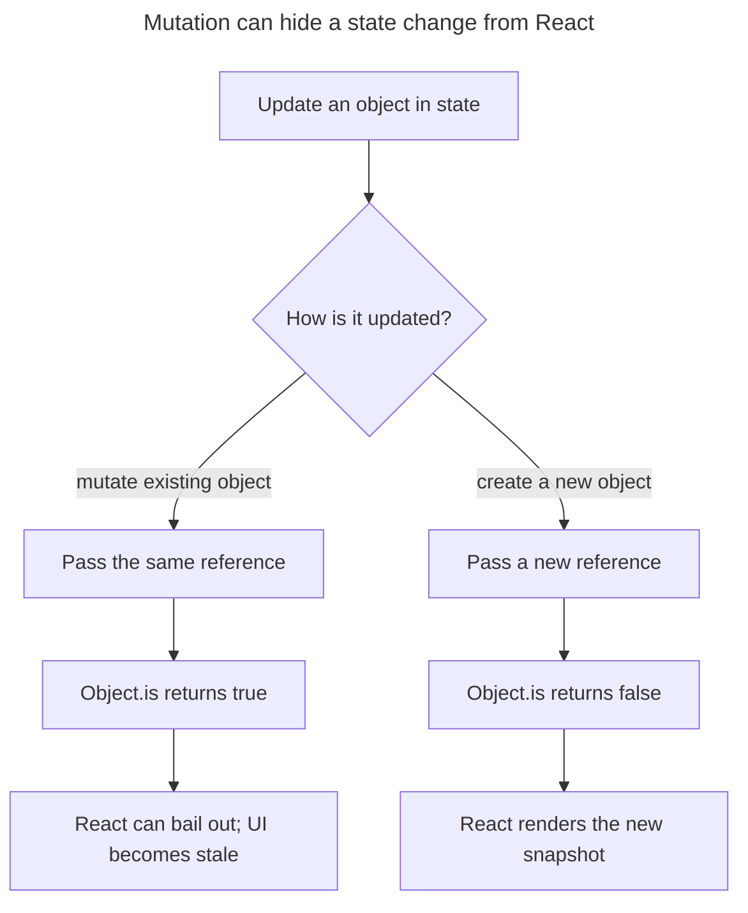

## TL;DR

React treats state as a read-only snapshot. Mutating an object or array in place keeps the same reference, so an `Object.is` state bailout, memoized child, memoized calculation, or Effect dependency may not observe a change. Mutation also alters older render snapshots that still reference the object, making behavior harder to reason about and incompatible with features that rely on snapshot semantics. Produce a new object or array with spreads, non-mutating methods such as `map`/`filter`/`toSorted`, or a helper such as Immer.

---

## Why does React recommend against mutating state?

React treats state as an immutable snapshot so queued renders, equality checks, and concurrent work can reason about past and next values independently.

### A quick terminology note

In modern React, state is updated by the setter returned from `useState` (or by `dispatch` from `useReducer`). The class-based `this.setState` API still exists but is rarely used in new code. Both APIs share the same expectation: you give React a **new** state value rather than mutating the existing one. The rest of this answer focuses on the hooks-based APIs.

### Where reference equality actually matters

A common misconception is that mutating state breaks the "virtual DOM diff." That is not quite right — the diff happens against the rendered element tree, not against the state object. The places where state immutability genuinely matters are:

- **`Object.is` bailout in `useState` / `useReducer`**: When you call the setter (or return a value from a reducer), React compares the new value with the current one using `Object.is`. If they are the same reference, React can skip re-rendering the component. Mutate-in-place returns the same reference, so React thinks nothing changed and skips the render — but the data has actually changed, so the UI goes stale.
- **`React.memo`, `useMemo`, `useCallback`, and `useEffect` dependencies**: These all compare values across renders with `Object.is`. A mutated array or object still has the same reference, so memoized children will not re-render and effects will not re-run, even though their underlying data is now different.
- **Render snapshots and concurrent features**: A render conceptually receives a snapshot of props and state. Mutating an object shared by past and in-progress renders changes those snapshots behind React's back, which makes interruptible or restartable rendering unsafe to reason about.
- **History-based tooling**: State-management tools such as Redux DevTools can record and replay immutable state snapshots. Mutation overwrites shared objects and makes that history unreliable. React DevTools itself inspects component state but does not provide Redux-style time travel.

### How the state bailout behaves

When the next state is `Object.is`-equal to the current state, React skips re-rendering the component and its children. React may still call the component before applying that optimization in some cases, so code must not depend on exactly when the bailout occurs. Mutation is a problem because it produces "same value to React, changed data in memory."

Mutation and immutable replacement take opposite paths through the reference-equality check:



### Problems with mutating state

Mutation can hide updates from React and change values that earlier renders still conceptually own:

1. **Stale UI updates**: The bailout above means the UI does not refresh when the underlying data changed.
2. **Broken memoization**: Memoized children, memoized values, and effects all compare by reference and will silently skip updates.
3. **Broken snapshot semantics** under interruptible or restartable rendering.
4. **Lost debuggability**: Previous snapshots and history-based state tooling no longer represent what the application rendered.
5. **Hard-to-track bugs**: Multiple components or hooks may close over the same object reference. Mutating it can have spooky action-at-a-distance effects.

### How to update state correctly

Always produce a new value:

```javascript
const [user, setUser] = useState({ name: 'Ada', age: 36 });

// Incorrect: mutates the existing object — same reference, bailout fires.
user.age = 37;
setUser(user);

// Correct: a brand new object.
setUser({ ...user, age: 37 });

// Equally correct, and safer when the new value depends on the old one
// (avoids stale-closure issues across batched updates):
setUser((prev) => ({ ...prev, age: 37 }));
```

For arrays, prefer non-mutating methods like `map`, `filter`, `concat`, the spread operator, or the newer `toSorted`/`toReversed`/`toSpliced` (avoid `push`, `splice`, `sort`, `reverse` on state):

```javascript
const [items, setItems] = useState([3, 1, 2]);

// Incorrect: sort() mutates in place.
items.sort();
setItems(items);

// Correct.
setItems([...items].sort((a, b) => a - b));
// Or, with the modern non-mutating method:
setItems(items.toSorted((a, b) => a - b));
```

### When the spread gets painful: Immer

Spreading deeply nested state by hand is verbose and error-prone. [Immer](https://immerjs.github.io/immer/) is the de facto solution: you write code that _looks_ like mutation against a draft, and Immer produces a new immutable state for you. It is built into Redux Toolkit's `createSlice`, and the `useImmer` / `useImmerReducer` hooks plug directly into React.

```javascript
import { produce } from 'immer';

setUser((prev) =>
  produce(prev, (draft) => {
    draft.address.city = 'Singapore';
  }),
);
```

You get the ergonomics of mutation and the guarantees of immutability.

## Further reading

- [React documentation — Updating objects in state](https://react.dev/learn/updating-objects-in-state)
- [React documentation — Updating arrays in state](https://react.dev/learn/updating-arrays-in-state)
- [Immer documentation](https://immerjs.github.io/immer/)
- [Why not to mutate state in React](https://daveceddia.com/why-not-modify-react-state-directly/)
